# Appendix to: Forecasting Care Load and Placement Demand in the HHS Unaccompanied Children Program

This volume supports the research paper. It holds definitions, detailed tables, tuning logs, full model outputs, additional charts and all raw source code. Section, table and figure numbers without a letter refer to the main paper, and its reference list applies here too.

<!-- toc -->

## Appendix A. KPI Definitions and Length-of-Stay Reconciliation

This appendix defines every indicator used in the paper and in the dashboard.

### A.1 Forecast KPIs

**Table A1.** Forecast KPIs

| KPI | Definition |
|---|---|
| Forecast Accuracy (%) | 100 − WAPE, where WAPE = Σ\|error\| / Σ\|actual\| on the test window; undefined when all actuals are zero |
| Surge Lead Time | Days between the start of the unbroken alert streak and the threshold crossing |
| Capacity Breach Probability | P(care load > threshold), from the point forecast plus walk-forward errors for that horizon (last 26 weeks of observable errors); threshold supplied by the user |
| Forecast Stability Index | 100 / (1 + mean revision for the same target date between consecutive origins ÷ mean actual daily change) |
| Model robustness | Win-rate vs naive across test weeks; error growth from week 1 to week 4; interval coverage |

### A.2 Descriptive pipeline KPIs

All computed on reported days only. Stocks: children in CBP custody, children in HHS care. Flows: apprehensions, transfers, discharges. These definitions are the ones shown in the dashboard tooltips (`src/kpi_calculations.py`, `KPI_DEFINITIONS`).

**Table A2.** Descriptive pipeline KPIs

| KPI | Definition |
|---|---|
| HHS census at period end | Children in HHS care on the last reported day of the period (stock) |
| HHS census change | Last minus first reported HHS census in the period (stock change, not a sum) |
| Peak HHS census | Highest reported HHS census in the period, with its date |
| CBP custody at period end | Children in CBP custody on the last trusted report of the period (stock) |
| Apprehensions per reported day | Mean of daily CBP apprehensions over reported days |
| Transfers into HHS per reported day | Mean of daily transfers out of CBP into HHS over reported days |
| Discharges per reported day | Mean of daily HHS discharges (mostly to sponsors) over reported days |
| Recorded net intake per reported day | Mean of (transfers - discharges) on days with both reported. Recorded flows do not close the census balance (about +3 children/day unexplained), so use the census change for backlog |
| CBP transfer rate (%/day) | 100 x sum(transfers) / sum(children in CBP custody): share of the CBP population moved to HHS per day |
| HHS discharge rate (%/day) | 100 x sum(discharges) / sum(children in HHS care): share of the HHS population discharged per day |
| Recorded throughput (exits per entry) | sum(discharges) / sum(transfers): above 1 = recorded exits exceed entries. Not used for alerts: it misses unreported Fri/Sat flows and non-CBP admissions |
| Implied average stay in HHS care (days) | Little's law, ratio of period means: sum(children in HHS care) / sum(discharges) = 100 / discharge rate |
| Implied CBP holding time (days) | Little's law: sum(children in CBP custody) / sum(transfers). An approximation of the average time in CBP custody before transfer (an upper bound if children also leave CBP by other routes); compare with the 72-hour transfer standard |
| CBP pass-through (transfers per apprehension) | sum(transfers) / sum(apprehensions) on days with both reported |

### A.3 Alert rules

**Table A3.** Alert rules in full

| Indicator | Value | Watch | Alert | Window and data requirement |
|---|---|---|---|---|
| HHS census growth | 100 × (census / census at the last report ≥ 28 days earlier − 1) | ≥ 5% | ≥ 10% | Lagged report must be within 7 days of the 28-day mark |
| Discharge slowdown | 100 × (1 − 7-day discharge rate / median 7-day rate of the previous 8 weeks) | ≥ 15% | ≥ 30% | ≥ 3 reports in the 7-day window; ≥ 15 rates in the baseline |
| CBP holding time | Σ custody / Σ transfers over 7 days (∞ if no transfers while children are held) | ≥ 2 days | ≥ 3 days | ≥ 3 reports with both values; trusted CBP data only |

Overall status = worst indicator level (Normal, Watch, Alert); indicators without a complete window are ignored ("insufficient data" if none is available).

### A.4 Implied length of stay: two definitions

Section 3.3 of the paper averages a 28-day smoothed daily ratio (calendar grid) over fixed windows. The dashboard and Section 8 of the paper use the ratio of period means over reported days, so the value equals 100 ÷ the discharge rate for any selected period. On the same windows the two definitions differ by 4–5%:

**Table A4.** Implied length of stay under the two definitions

| Window | Definition in Section 3.3 of the paper | Ratio of reported-day means | Difference |
|---|---|---|---|
| 22 Aug 2024 – 17 Feb 2025 ("before the break" in Section 3.3 of the paper) | 35.9 days | 37.2 days | +3.7% |
| 17 Mar – 21 Dec 2025 (current regime) | 203.2 days | 192.3 days | −5.4% |

## Appendix B. Data-Quality Detail

This appendix gives the full evidence behind Section 2 of the paper.

### B.1 Source fields and the population balance

The source file contains 1,170 rows below its header line, of which 720 are daily reports and 450 are blank padding rows. Each report has six fields:

**Table B1.** Source fields and their role in the HHS population balance

| Field | Meaning | Type | Role in the HHS population balance |
|---|---|---|---|
| Date | Reporting date (text, newest first) | index | |
| Children apprehended and placed in CBP custody | CBP intake | daily count | upstream, not part of the HHS balance |
| Children in CBP custody | CBP care load | stock (snapshot) | upstream pipeline |
| Children transferred out of CBP custody | Flow into HHS | daily count | admissions from CBP (one movement, counted once) |
| Children in HHS care | HHS care load | stock (snapshot) | closing population |
| Children discharged from HHS care | Sponsor placements | daily count | exits |

The distinction between **stocks** (levels) and **flows** (daily counts) matters throughout: a stock must reconcile with its flows, and that identity becomes the main data-quality test. The testable balance is *closing = opening + transfers in − discharges + (unrecorded other admissions − other exits)*. The file contains no columns for non-CBP admissions, other exits or bed capacity; these gaps are measured and reported (Appendix B.6) rather than invented, and every capacity threshold in this study is a user input or an illustration.

### B.2 Input validation

Two validation layers run before any analysis. **Schema validation** stops a malformed file with a message naming the column, file line and value: six columns in the documented order, at least one data row and at least 365 reports, dates in the documented format (ISO dates accepted and reported; time-stamped or other text rejected), numbers with optional thousands separators (blank and `N/A` mean missing; other text is rejected), no empty or constant target columns, and a daily cadence (median gap ≤ 3 days). **Plausibility validation** quarantines impossible values (negative counts; a care load more than 1.5× or less than 1/1.5× the median of the three reports on either side) by setting them to missing and listing them (never replacing them with zero), and flags unusual but possible values (non-integer counts; flows more than 5× their local median) for review.

On the real file every check passes and nothing is quarantined or flagged; the largest care-load deviation from neighbouring reports is ×1.11 and the largest flow ratio 3.2×, far inside the limits. The negative cases are exercised on synthetic files in the automated test suite (Appendix G).

### B.3 Reporting cadence

Reports arrive Sunday to Thursday. In three years there are only 2 Friday reports and none on a Saturday (Figure B1). Gaps of 3 days (Thursday→Sunday) are the second most common interval, and about a third of calendar days (355 of 1,075) have no report. Missing days are therefore **structural, not random**, and Friday/Saturday flows are never observed.

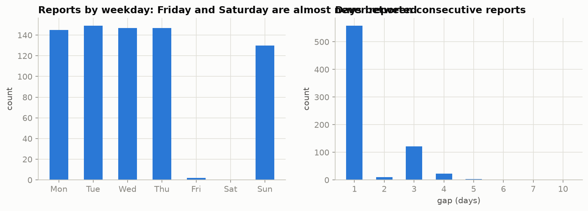

### B.4 Stale reports

Five reports repeat the previous report's care load *and* discharges exactly, while their CBP fields change: 8 Jan 2024, 26 Feb 2024, 25 Jun 2024, 27 Mar 2025 and 14 May 2025. These are carry-forwards. They were set to missing, re-estimated by interpolation, and never used as a scored target.

### B.5 Copied CBP records

A CBP report is a triple (apprehended, in custody, transferred), and identical triples on different dates should be rare. In this file, 374 of 720 rows share their triple with another date. The earlier copies form one **contiguous block of 251 reports from 12 Jan 2023 to 30 Jan 2024**; 100% of 2023 CBP rows are copies. For example, the triple (56, 82, 68) appears on 1 Jun 2023, 15 Oct 2023, 27 Nov 2023, 26 Dec 2023 and 9 Jan 2025, each time alongside a completely different HHS care load. (The detector requires a run of at least 14 consecutive copies before declaring a corrupted block, so isolated chance repeats at low counts on a future refresh are not masked.)

**Proof via the stock-flow identity.** On consecutive days, the change in HHS care should equal transfers in minus discharges out. Figure B2 tests this:

**Table B2.** Stock-flow identity test

| Period | Day pairs | corr(ΔHHS, net flow) | Mean residual per day |
|---|---|---|---|
| Copied CBP block (2023 – Jan 2024) | 192 | **0.51** | **+190 children** |
| Trusted (Feb 2024 →) | 357 | **0.90** | +2.6 children |

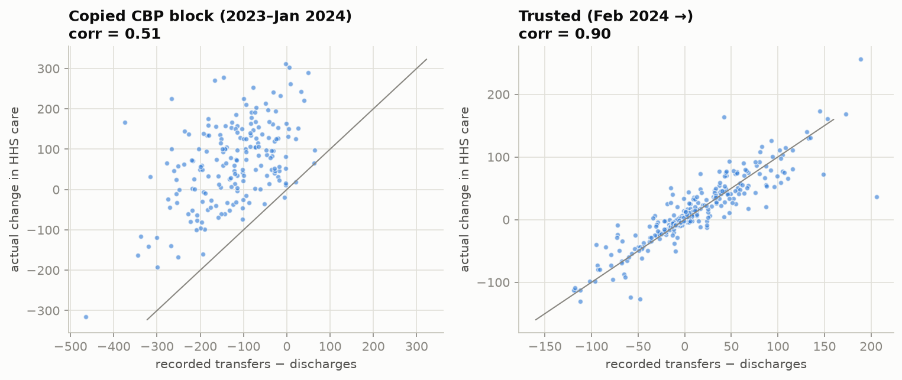

Admissions implied by the HHS columns alone (ΔHHS + discharges) ran at 280–400 per day in 2023, while recorded transfers captured only 34–57% of that. In Q2–Q4 2024 recorded transfers match implied admissions (97–100%); at the very low 2025 volumes the ratio is 67–92%, consistent with the roughly 3 children a day that enter care outside recorded transfers (Appendix B.6). **Conclusion:** the CBP columns for 2023 – January 2024 are corrupted; the HHS columns reconcile wherever they can be checked (February 2024 onward) and are kept for the whole history, although they cannot be cross-checked inside the copied block itself.

**Origin-time check.** Copy detection is retrospective: a copy is recognised only once its later original exists. All originals of the copied rows are dated 26 June 2024 – 12 February 2025, before the first forecast origin (22 June 2025). Re-running the detection, and the change-point search of Section 3.2 of the paper, with data up to that origin only gives the identical block and identical break dates, so the masks and training windows used in the backtest would have been available in real time.

### B.6 What the counts mean, and whether interpolating them is justified

Interpolating a stock between snapshots is natural; interpolating daily **counts** needs evidence. Three checks were run (current regime unless stated):

1. **Sunday counts are single-day counts, not 3-day totals.** Sunday discharges average 7.2 against 12.8 on Monday–Thursday; a weekend total would be about three times a weekday figure.
2. **Interpolated weekend flows reconcile with the stock.** The care-load change not explained by recorded flows is 2.97 children/day between consecutive weekday reports and 3.42/day across Thursday→Sunday gaps with interpolated Friday/Saturday flows, a difference of about 0.45/day. Across the trusted period from February 2024 onward, which the high-volume 2024 reports dominate, the weekend gap was large (−18.8/day vs +2.6/day), so 2024 weekend flow features are biased; they enter only the ML training rows, which a 180-day recency half-life down-weights.
3. **The choice barely changes model inputs.** 14-day flow means from the interpolated grid differ by 3.2% (transfers) and 4.8% (discharges) from means built on reported days only, with correlation ≥ 0.999.

Zero-filling was rejected because the stock keeps moving over weekends. The constant ~3 children/day that recorded flows never explain is consistent with admissions from outside CBP or a definitional difference; it is carried as a measured reconciliation term (+3.35 children/day over the last 60 days), not as a modelled flow.

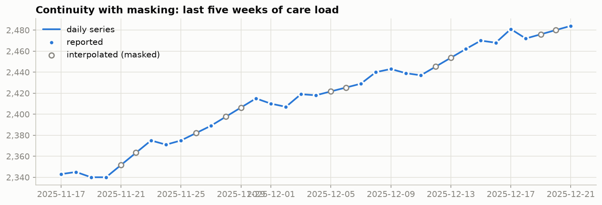

### B.7 Decisions

**Table B3.** Data-quality decisions with their evidence

| Issue | Evidence | Treatment |
|---|---|---|
| 450 blank rows; text dates; comma numbers; newest-first order | Raw audit | Dropped, parsed, typed, sorted (stable sort) |
| Duplicate dates (none in this file) | Stable sort + conflict listing | Identical repeats dropped; for conflicting repeats the first record in file order is kept and printed (the file carries no revision timestamp) |
| Malformed or implausible values on a refresh (none in this file) | Validation rules (Appendix B.2) | Stop with a clear message, or quarantine to missing and list |
| Saturday never reported, Friday almost never (2 reports) | Weekday counts | Daily calendar + time interpolation, with an `is_reported` mask |
| 5 stale HHS reports | Exact repeats | Set to missing, interpolated, never scored |
| CBP block copied (Jan 2023 – Jan 2024) | Duplicate triples + broken identity | CBP fields masked; ML trained on the trusted period only |
| HHS columns | Reconcile where CBP is trusted | Kept for the full history (EDA, surge replay) |

**Leakage guard.** An interpolated Friday value is computed from the following Sunday. A forecast issued "as of Friday" would therefore secretly know Sunday. Every forecast is issued from a reported day and scored only on reported days with a genuine value for that series, so interpolated values fill rolling-window features *between* reports but never carry future information.

## Appendix C. Additional Exploratory Analysis

This appendix holds exploratory results and notebook charts that the paper summarises.

### C.1 Structural break and length of stay

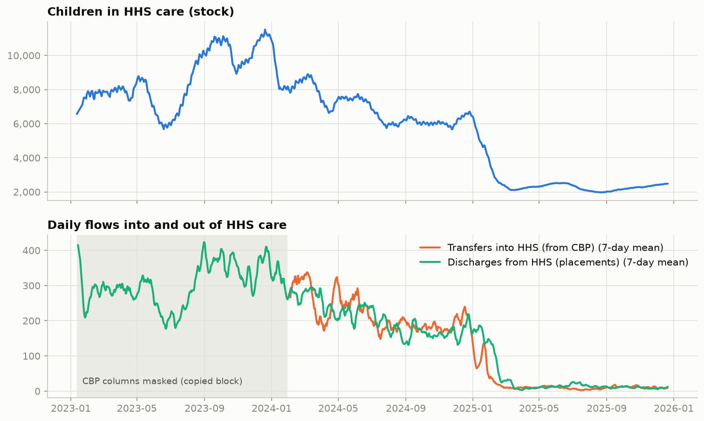

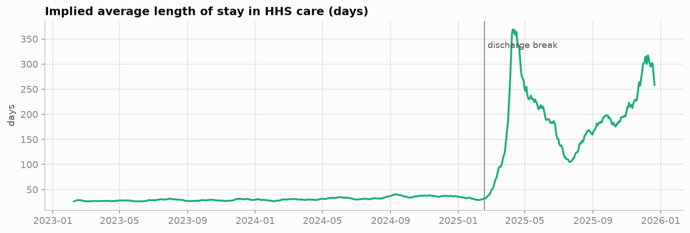

### C.2 Net pressure

Net pressure (transfers − discharges) is the flow signal that drives the stock. In the current regime it explains the shape of the care-load curve (Figure C3): net outflow (down to −19 children/day in mid-July) drove the June–August 2025 drawdown (about 2,500 → 1,972). Small recorded net inflows since September (about +1/day) coincide with the climb, but explain only part of it; the reconciliation term and the weekend pattern below account for the rest.

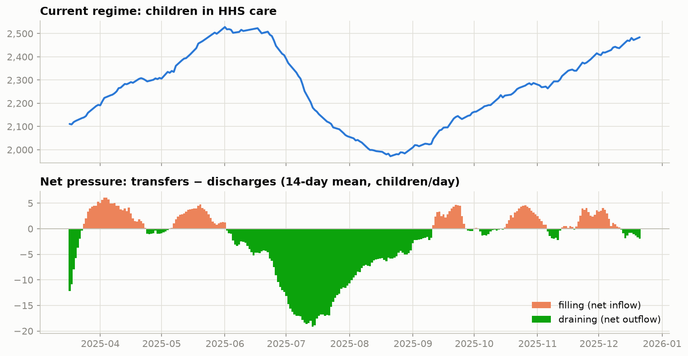

### C.3 Weekly structure and the weekend ratchet

On reported days in the current regime, discharges peak mid-week (Thursday 14.9, Wednesday 13.5) and are lowest on Sundays (7.2). Transfers are flatter (8.7–10.8). Comparing care-load changes on weekday transitions with changes across the unreported Thursday→Sunday gap reveals a striking pattern:

**Table C1.** Care-load change per day: weekdays against the Thursday-to-Sunday gap

| Period | Weekday change / day | Weekend (Thu→Sun) change / day |
|---|---|---|
| 2023 – Jan 2024 | +66.8 | −76.6 |
| Feb 2024 – break | +19.4 | −64.5 |
| **Current regime** | **−0.3** | **+3.4** |

Over the current regime, care load rose by 373. Weekday transitions netted **−40**, Thursday→Sunday gaps **+323** and other multi-day reporting gaps (holidays, a June outage and removed stale reports) **+90**. In other words, **net growth has come across weekends**, when arrivals continue but placements slow. The pattern is the reverse of the high-volume era, which is another reason to model the current regime separately.

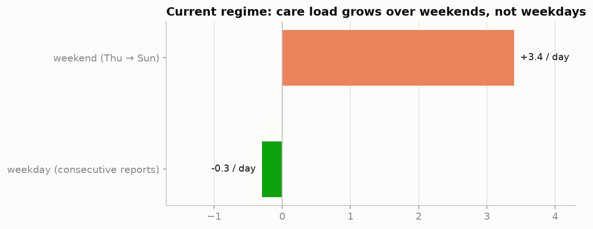

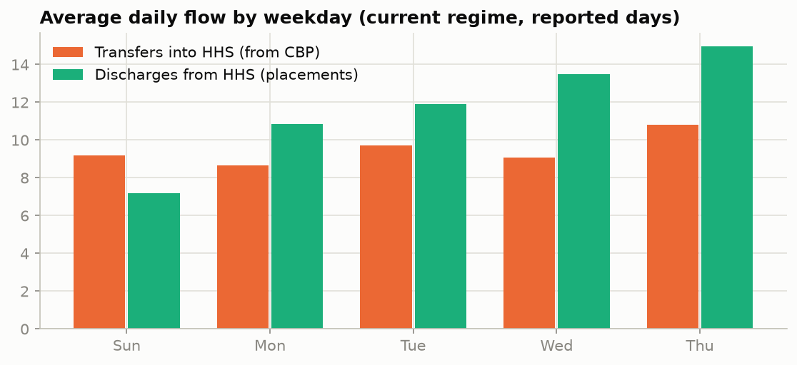

### C.4 Monthly pattern, outliers, surge periods and correlations

- **No stable month-of-year pattern.** Month-end care load followed a different path every year (peak 11,516 on 20 Dec 2023; month-end values of about 6,000–8,700 through 2024; collapse in early 2025), and the month-to-month direction agreed between 2023 and 2024 in only 5 of 11 months (Figure C6). Each calendar month occurs at most three times, once on each side of the break, so month effects cannot be estimated.
- **Outliers.** The largest robust deviations (MAD z-scores against a centred 29-day median) occur at the low volumes of 2025: 29 transfers on 11 Sep 2025 against a local median of 11 (z = 12.1) and 39 discharges on 10 Jul 2025 against 17 (z = 4.9). They pass the plausibility rules and are kept.
- **Surge periods.** The fastest 28-day rises in care load were all in 2023: +2,806 (+43%) to 13 Aug 2023 (on the interpolated grid, because no reports exist for 13–15 Aug 2023; on reported days the largest rise is +37.6% to 16 Aug 2023, Section 8.4 of the paper), +1,342 (+20%) to 9 Feb 2023 and +1,695 (+17%) to the 11,516 peak on 20 Dec 2023.
- **Correlations (associations, not causal effects).** In the current regime the daily care-load change rises with transfers (+0.47) and falls with discharges (−0.61). Transfers correlate 0.38 with same-day apprehensions but 0.59 and 0.58 with apprehensions one and two days earlier, so CBP intake leads HHS transfers by one to two days.

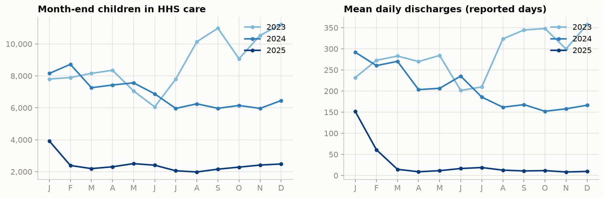

### C.5 Decomposition and stationarity

STL decomposition (weekly period, robust fitting) gives a weekly seasonal strength of 0.42 for discharges but only 0.14 for care load (Figure C7). With fewer than ten months in the current regime and an irregular reporting cadence, the decomposition is descriptive; no annual component can be estimated.

- **Care load.** ADF and KPSS are inconclusive on the short regime window (low test power). Because a stock is integrated by construction (care_t = care_t−1 + in − out) and shows multi-month trends, care load is modelled with one difference (d = 1).
- **Flows.** Transfers test stationary. Discharges test non-stationary in level because of a temporary mid-2025 placement push, and are modelled in logs with a constant (d = 0), so forecasts revert to the regime's typical level instead of extrapolating a temporary surge.

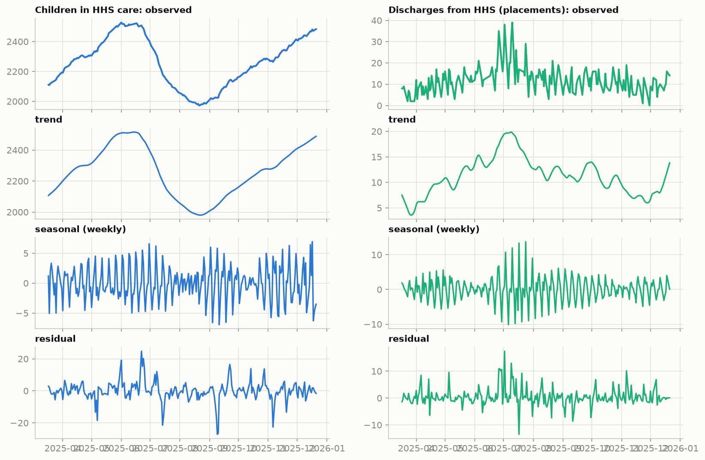

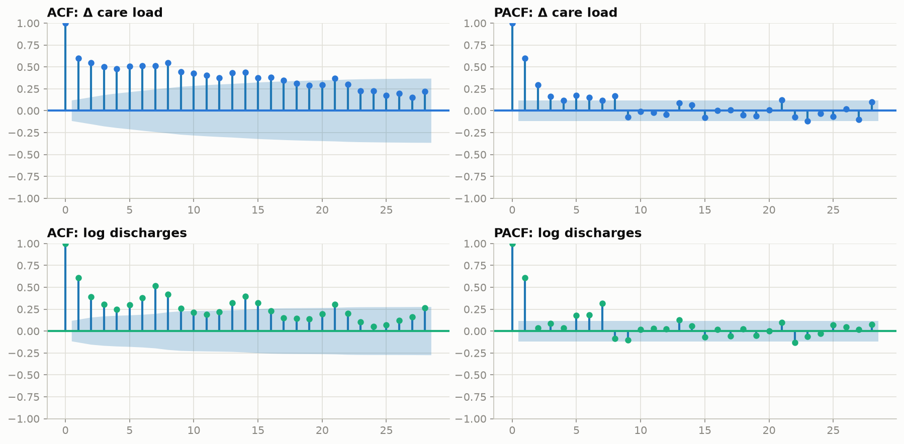

**Stationarity tests (executed notebook output).**

```
        series            form  ADF p  KPSS p         verdict
0     hhs_care           level  0.106   0.086    inconclusive
1     hhs_care  1st difference  0.350   0.079    inconclusive
2   discharged           level  0.171   0.050  non-stationary
3   discharged  1st difference  0.000   0.100      stationary
4  transferred           level  0.035   0.100      stationary
5  transferred  1st difference  0.000   0.100      stationary
```

## Appendix D. Feature and Leakage Audit

This appendix documents every model input and the tests that show none of them sees the future.

### D.1 Time-series preparation

1. Re-index onto a continuous daily calendar (1,075 days).
2. Time-weighted linear interpolation of interior gaps (justified in Appendix B.6).
3. An `is_reported` mask that restricts forecast origins to genuine, non-stale reports, and a per-series "observed" mask that restricts scored and training targets to genuine values of that series.
4. CBP fields masked in the copied block.

### D.2 Feature groups, targets and perturbation test

All features describe information available at the end of origin day *t*. The ML models use a direct multi-horizon design: one row per (origin, horizon h = 1…28), so a single model learns all horizons and never needs predicted or actual future values as inputs.

**Table D1.** Feature groups in full

| Group | Features |
|---|---|
| Lags (t−1, t−7, t−14) | care-load log-changes; flow lags relative to their 14-day mean |
| Rolling mean & variance (7 / 14 days) | care-load deviation from rolling mean, rolling volatility; flow rolling means and log-variances |
| Flow-based signals | net pressure per 100 children (origin day, 7- and 14-day means); CBP pipeline per 100 children; flow rates per 100 children |
| Calendar | target weekday, US federal-holiday window (±1 day), origin weekday, horizon |
| Seasonal anchor | same weekday last week relative to today's level |

**Scale-free targets.** The 2024 and 2025 regimes differ twentyfold in volume. ML targets are therefore log-ratios: log(care_t+h / care_t) for the stock, and log1p(flow_t+h) − log1p(14-day mean) for flows.

**Leakage audit.** Each of the 40 features is documented with its definition, source columns, look-back window, availability at the origin and horizon suitability (`artifacts/feature_leakage_audit.csv`). An executed perturbation test then scaled every report after a cut-off (18 Oct 2025) by 1.5, rebuilt the whole preparation and all features, and compared values at the 410 reported origins up to the cut-off: **0** of the feature values changed (40 features × 3 series × horizons 1/7/14/28). Negative controls confirm that the test detects look-ahead: the target changed in 99 rows, and 2 of the 3 interpolated days just before the cut-off changed. The net-pressure feature is labelled as an incomplete balance (Appendix B.6).

### D.3 The month feature

*The figures in the first two paragraphs of this subsection come from a development run that is not kept in the delivered notebook, so they cannot be reproduced from the delivered outputs. The exceptions are the post-removal test errors (38 and 31), which are.* The first full run included the target month as a calendar feature. It became the **single most important care-load feature** (about 30% of Random Forest importance), and the production forecast showed Random Forest falling from 2,525 on 31 December to 2,282 on 1 January, a **10% cliff at the month boundary**. The trusted history contains only one January, January 2025, which is the crash at the early-2025 structural break. The model had learned a regime change disguised as seasonality.

The month feature was removed because of that cliff, not because of a test score. For transparency, removing it raised Random Forest's test error (MAE 25 → 38) but lowered Gradient Boosting's (40 → 31), and the ensemble stayed the best test model. Week of year has the same flaw and was never added. The holiday-window feature changes forecasts by at most about 4 children and was kept.

### D.4 Full feature audit

Each row is one of the 40 features. The last column counts values that changed in the perturbation test.

**Table D2.** Feature leakage audit

| feature | definition | source columns | look-back window | available at origin t? | horizon suitability | changed under perturbation |
|---|---|---|---|---|---|---|
| care_logchg_1 | log(care[t] / care[t−1]) | hhs_care | t−1 … t | yes (≤ t only) | all h; information ages with h | 0 |
| care_logchg_7 | log(care[t] / care[t−7]) | hhs_care | t−7 … t | yes (≤ t only) | all h; information ages with h | 0 |
| care_logchg_14 | log(care[t] / care[t−14]) | hhs_care | t−14 … t | yes (≤ t only) | all h; information ages with h | 0 |
| care_dev_ma7 | log(care[t] / 7-day mean of care) | hhs_care | t−6 … t | yes (≤ t only) | all h; information ages with h | 0 |
| care_vol7 | std of daily care change over 7 days ÷ care[t] × 100 | hhs_care | t−7 … t | yes (≤ t only) | all h; information ages with h | 0 |
| net_rate_ma7 | 7-day mean of (transfers − discharges) ÷ care[t] × 100 | transferred, discharged, hhs_care | t−6 … t | yes (≤ t only) | all h; information ages with h | 0 |
| care_dev_ma14 | log(care[t] / 14-day mean of care) | hhs_care | t−13 … t | yes (≤ t only) | all h; information ages with h | 0 |
| care_vol14 | std of daily care change over 14 days ÷ care[t] × 100 | hhs_care | t−14 … t | yes (≤ t only) | all h; information ages with h | 0 |
| net_rate_ma14 | 14-day mean of (transfers − discharges) ÷ care[t] × 100 | transferred, discharged, hhs_care | t−13 … t | yes (≤ t only) | all h; information ages with h | 0 |
| net_rate_lag1 | (transfers − discharges) on the origin day ÷ care[t] × 100 | transferred, discharged, hhs_care | t | yes (≤ t only) | all h; information ages with h | 0 |
| cbp_pipeline_rate | children in CBP custody ÷ care[t] × 100 | cbp_custody, hhs_care | t | yes (≤ t only) | all h; information ages with h | 0 |
| apprehended_lag0 | log1p(apprehended[t−0]) − log1p(14-day mean) | apprehended | t−13 … t | yes (≤ t only) | all h; information ages with h | 0 |
| apprehended_lag1 | log1p(apprehended[t−1]) − log1p(14-day mean) | apprehended | t−13 … t | yes (≤ t only) | all h; information ages with h | 0 |
| apprehended_lag7 | log1p(apprehended[t−7]) − log1p(14-day mean) | apprehended | t−13 … t | yes (≤ t only) | all h; information ages with h | 0 |
| apprehended_lag14 | log1p(apprehended[t−14]) − log1p(14-day mean) | apprehended | t−14 … t | yes (≤ t only) | all h; information ages with h | 0 |
| apprehended_ma7 | log1p(7-day mean) − log1p(14-day mean) of apprehended | apprehended | t−13 … t | yes (≤ t only) | all h; information ages with h | 0 |
| apprehended_logvar7 | variance of log1p(apprehended) over 7 days | apprehended | t−6 … t | yes (≤ t only) | all h; information ages with h | 0 |
| apprehended_logvar14 | variance of log1p(apprehended) over 14 days | apprehended | t−13 … t | yes (≤ t only) | all h; information ages with h | 0 |
| apprehended_rate14 | 14-day mean of apprehended ÷ care[t] × 100 | apprehended, hhs_care | t−13 … t | yes (≤ t only) | all h; information ages with h | 0 |
| transferred_lag0 | log1p(transferred[t−0]) − log1p(14-day mean) | transferred | t−13 … t | yes (≤ t only) | all h; information ages with h | 0 |
| transferred_lag1 | log1p(transferred[t−1]) − log1p(14-day mean) | transferred | t−13 … t | yes (≤ t only) | all h; information ages with h | 0 |
| transferred_lag7 | log1p(transferred[t−7]) − log1p(14-day mean) | transferred | t−13 … t | yes (≤ t only) | all h; information ages with h | 0 |
| transferred_lag14 | log1p(transferred[t−14]) − log1p(14-day mean) | transferred | t−14 … t | yes (≤ t only) | all h; information ages with h | 0 |
| transferred_ma7 | log1p(7-day mean) − log1p(14-day mean) of transferred | transferred | t−13 … t | yes (≤ t only) | all h; information ages with h | 0 |
| transferred_logvar7 | variance of log1p(transferred) over 7 days | transferred | t−6 … t | yes (≤ t only) | all h; information ages with h | 0 |
| transferred_logvar14 | variance of log1p(transferred) over 14 days | transferred | t−13 … t | yes (≤ t only) | all h; information ages with h | 0 |
| transferred_rate14 | 14-day mean of transferred ÷ care[t] × 100 | transferred, hhs_care | t−13 … t | yes (≤ t only) | all h; information ages with h | 0 |
| discharged_lag0 | log1p(discharged[t−0]) − log1p(14-day mean) | discharged | t−13 … t | yes (≤ t only) | all h; information ages with h | 0 |
| discharged_lag1 | log1p(discharged[t−1]) − log1p(14-day mean) | discharged | t−13 … t | yes (≤ t only) | all h; information ages with h | 0 |
| discharged_lag7 | log1p(discharged[t−7]) − log1p(14-day mean) | discharged | t−13 … t | yes (≤ t only) | all h; information ages with h | 0 |
| discharged_lag14 | log1p(discharged[t−14]) − log1p(14-day mean) | discharged | t−14 … t | yes (≤ t only) | all h; information ages with h | 0 |
| discharged_ma7 | log1p(7-day mean) − log1p(14-day mean) of discharged | discharged | t−13 … t | yes (≤ t only) | all h; information ages with h | 0 |
| discharged_logvar7 | variance of log1p(discharged) over 7 days | discharged | t−6 … t | yes (≤ t only) | all h; information ages with h | 0 |
| discharged_logvar14 | variance of log1p(discharged) over 14 days | discharged | t−13 … t | yes (≤ t only) | all h; information ages with h | 0 |
| discharged_rate14 | 14-day mean of discharged ÷ care[t] × 100 | discharged, hhs_care | t−13 … t | yes (≤ t only) | all h; information ages with h | 0 |
| origin_dow | weekday of the origin day | calendar | t | yes (≤ t only) | all h; information ages with h | 0 |
| h | forecast horizon in days | design | n/a | yes (deterministic) | built per horizon (direct strategy) | 0 |
| target_dow | weekday of the target day t+h | calendar | known in advance | yes (deterministic) | built per horizon (direct strategy) | 0 |
| target_holiday | target day within ±1 day of a US federal holiday | calendar (USFederalHolidayCalendar) | known in advance | yes (deterministic) | built per horizon (direct strategy) | 0 |
| seasonal_anchor | same-weekday value at t+h−7⌈h/7⌉ (≤ t) relative to today's level (flows: 14-day mean) | series being forecast | t−13 … t | yes (≤ t only) | built per horizon (direct strategy) | 0 |

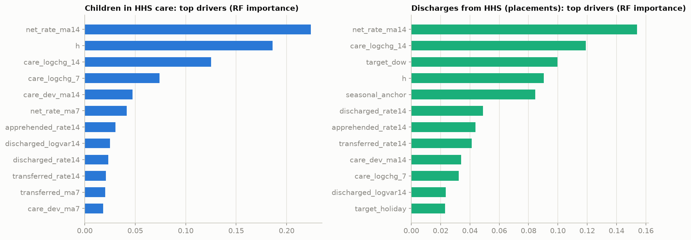

## Appendix E. Model Specifications and Tuning Logs

This appendix gives full model settings, the order-selection logs and the design of each experiment. SARIMA orders were searched by AIC. The machine-learning models use fixed settings, so no grid-search log exists for them.

### E.1 Train–test design

**Table E1.** Data used by each component

| Component | Data used |
|---|---|
| Statistical models (SARIMA, ETS) | current regime, 17 Mar 2025 → origin |
| ML models (RF, GB) | trusted period, 14 Feb 2024 → origin, recency-weighted (180-day half-life) |
| Calibration window (champion selection, interval calibration) | 22 Jun – 20 Sep 2025 |
| Test window (reporting only) | 21 Sep – 21 Dec 2025 |

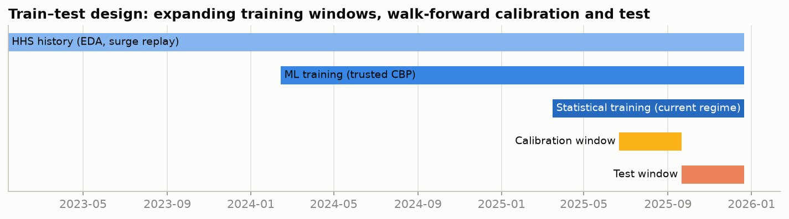

Forecasts are issued from **every reported day** (124 origins) for horizons 1–28. Models are re-estimated every 14 days and absorb each new observation in between, mirroring production use. The backtest produced 83,328 forecasts (7 models plus the ensemble), of which 52,464 had reported targets. A model whose fit or prediction fails is logged and replaced by naive persistence for that origin (flagged); in the delivered run no fit failed. The 28-day horizon covers four complete weekly cycles; 30-day forecasts were not validated.

**Training-window ablation.** A development experiment, not re-run in the delivered notebook, compared three ML training designs: the trusted window with recency weights, the trusted window without weights, and the current regime only. The decision rests on the **calibration** window alone: regime-only training was far worse early in the regime (calibration MAE 125 vs 89 for Random Forest, 126 vs 97 for Gradient Boosting, 5.8 vs 4.2 for discharges), when only about three months of history existed, so the recency-weighted trusted window was adopted.

### E.2 Model specifications and fallbacks

The statistical models and the STL, ADF and KPSS diagnostics use statsmodels (Seabold & Perktold, 2010); the machine-learning models use scikit-learn (Pedregosa et al., 2011).

**Table E2.** Models, specifications and failure fallbacks

| Family | Model | Specification | Failure condition → fallback |
|---|---|---|---|
| Baseline | Naive persistence | ŷ_t+h = y_t | none |
| Baseline | Seasonal naive | ŷ_t+h = y at the same weekday of the last week (≤ t) | none |
| Baseline | Moving average | 7-day mean, flat | none |
| Statistical | SARIMA | orders by AIC before the calibration window: care (1,1,1); discharges (1,0,1)(1,0,1)₇ + constant on log1p; transfers (1,0,0) + constant on log1p | < 56 days of history or non-convergence → previous fit, else naive |
| Statistical | ETS | care: additive error, damped additive trend, weekly season; flows: log1p, weekly season | < 28 days → previous fit, else naive |
| ML | Random Forest | 200 trees, min leaf 5, 50% features, 70% bootstrap sample | < 200 training rows → previous fit, else naive |
| ML | Gradient Boosting | 150 trees, depth 3, learning rate 0.07, Huber loss | as RF |
| Hybrid | Ensemble | equal-weight mean of SARIMA, ETS, RF, GB | components that fail contribute their flagged fallback |

**ARIMA vs SARIMA.** For each series the best non-seasonal and the best weekly-seasonal specification were compared (18 specifications fitted per series on pre-calibration data). Weekly terms earn their place only for discharges (ΔAIC −11.5: 74.9 vs 86.4); for care load and transfers the seasonal versions are worse (+3.4 and +3.7). Walk-forward errors on the calibration window confirm every AIC choice (care 55.1 vs 55.3, discharges 4.09 vs 4.76, transfers 4.47 vs 4.60, selected vs other family).

### E.3 SARIMA order-selection log

**Best specification per series, chosen by AIC on data before the calibration window (executed notebook output).**

```
hhs_care     best SARIMA(1, 1, 1)x(0, 0, 0, 7) trend=n  AIC=617.9
discharged   best SARIMA(1, 0, 1)x(1, 0, 1, 7) trend=c  AIC=74.9
transferred  best SARIMA(1, 0, 0)x(0, 0, 0, 7) trend=c  AIC=84.6
```

**Best non-seasonal against best weekly-seasonal specification (executed notebook output).**

```
            best ARIMA  AIC ARIMA             best SARIMA  AIC SARIMA  ΔAIC (SARIMA − ARIMA)  specs fitted selected
series                                                                                                             
hhs_care     (1, 1, 1)      617.9  (1, 1, 1)x(1, 0, 1, 7)       621.3                    3.4            18    ARIMA
discharged   (1, 0, 2)       86.4  (1, 0, 1)x(1, 0, 1, 7)        74.9                  -11.5            18   SARIMA
transferred  (1, 0, 0)       84.6  (1, 0, 0)x(1, 0, 1, 7)        88.4                    3.7            18    ARIMA
```

**Selected specification against the other family, walked forward (executed notebook output).**

```
Alternative specifications walked forward in 24s
                                selected (lowest AIC)  MAE selected                  other family  MAE other
series      period                                                                                          
hhs_care    calibration                ARIMA(1, 1, 1)         55.10  SARIMA(1, 1, 1)x(1, 0, 1, 7)      55.27
            test                       ARIMA(1, 1, 1)         32.00  SARIMA(1, 1, 1)x(1, 0, 1, 7)      31.31
discharged  calibration  SARIMA(1, 0, 1)x(1, 0, 1, 7)          4.09                ARIMA(1, 0, 2)       4.76
            test         SARIMA(1, 0, 1)x(1, 0, 1, 7)          3.33                ARIMA(1, 0, 2)       3.38
transferred calibration                ARIMA(1, 0, 0)          4.47  SARIMA(1, 0, 0)x(1, 0, 1, 7)       4.60
            test                       ARIMA(1, 0, 0)          4.04  SARIMA(1, 0, 0)x(1, 0, 1, 7)       4.07
```

### E.4 Evaluation metrics

MAE, RMSE, MAPE (non-zero actuals only; the number of excluded zero actuals is reported, e.g. 18 discharge forecasts on test), WAPE = Σ|error| / Σ|actual|, and **Forecast Accuracy = 100 − WAPE** = 100 × (1 − Σ|y − ŷ| / Σ|y|). Accuracy is a volume-weighted complement of relative error, not a transformation of MAE or MAPE; it is 100 for a perfect forecast, can be negative when errors exceed volumes, and is undefined (reported as missing, never as a number) when all actuals are zero. Bias = mean(ŷ − y). Errors are analysed by horizon (1–28 days, weekly buckets, and a scorecard at 1/7/14/28 days). Diebold–Mariano tests with Bartlett variance and the Harvey correction test whether gains over naive are significant.

### E.5 Uncertainty quantification

For each model, series and horizon, intervals add the empirical quantiles of out-of-sample errors (pooled over h ± 2) to the point forecast. Two calibration rules are evaluated on the test window: the **fixed calibration window** (split conformal), and the **rolling-origin rule** that the production forecast uses: at each origin, the error quantiles of all forecasts from the previous 26 weeks of origins whose target date has already been observed (a 13-week variant as sensitivity check). The rolling rule was fixed before its test results were inspected. Flow bounds are floored at zero; flooring cannot change coverage for non-negative actuals but is a truncation, not a count model.

### E.6 Recursive against direct forecasting

To isolate the multi-step strategy, two Gradient Boosting models (100 trees, depth 3, Huber loss, recency weights) were given identical target-only inputs (the last 14 transformed values, their 7- and 14-day means, and the target weekday) and walked forward over the same 124 origins (refit every 28 days): a **direct** stacked model told the horizon, and a **recursive** one-step model fed its own predictions. The recursive model must step through every calendar day, so it trains on interpolated Friday/Saturday values; both are scored on reported days only.

**Results.**

**Table E3.** Recursive against direct, target-only Gradient Boosting (MAE)

| Recursive vs direct (target-only GB, MAE) | 1–7 d | 8–14 d | 15–21 d | 22–28 d |
|---|---|---|---|---|
| Care load, test: direct / recursive | 24.3 / **13.0** | 27.0 / **23.9** | 41.1 / **33.1** | 64.7 / **40.6** |
| Care load, calibration: direct / recursive | 41.7 / **21.5** | 67.8 / **58.6** | 108.0 / **102.3** | 144.1 / **142.5** |
| Discharges, test: direct / recursive | 3.47 / **3.16** | **3.64** / 3.77 | **3.61** / 4.13 | **3.68** / 4.17 |

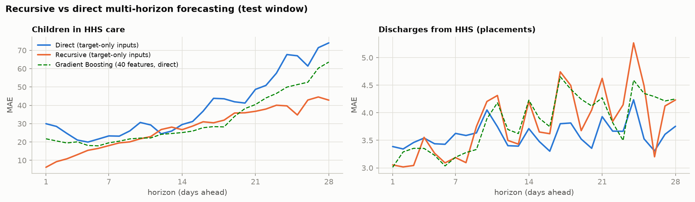

With identical inputs, the recursive strategy is better for the smooth care-load stock at every horizon in both windows, while for the noisy discharge flow it is better only in week 1 and worse from week 2 on the test window (from week 3 on the calibration window) as its own errors feed back. On the calibration window (the decision window) neither variant approaches the SARIMA champion (week averages of about 81 vs 55 children), although the recursive model would have beaten it on the test window (about 28 vs 32). The production design is unchanged; a recursive care-load learner is a candidate for the next model review.

### E.7 Early-warning design

A **surge event** is the first reported day care load crosses threshold *C* after at least 14 days below it. An **alert** fires at origin *t* when the probability of exceeding *C* within 28 days reaches *p*\*. **Lead time** is the length of the unbroken alert streak before the event. Sweeping *C* over many thresholds produces many events. The system is evaluated on the 2025 test window (champion and its calibrated errors) and in a **real-time replay of 2023–24** with a rolling 120-day damped-trend ETS model and analytic intervals (only the HHS columns are trustworthy then, so the replay model is univariate). The operating point p\* = 30% was chosen on the replay curve; the test window played no part in the choice.

### E.8 Scenario engine

Scenarios modify forecast flows and propagate the change through the stock-flow identity:

care^scenario_t+h = care^baseline_t+h + Σ (Δtransfers − Δdischarges)

The baseline path is a model forecast; every other path is a **hypothetical assumption**, not a prediction, and carries no probability of its own. The same engine runs in the dashboard's Scenario lab.

## Appendix F. Full Model Outputs

This appendix holds the complete result tables and the notebook charts behind Sections 6 to 8.

### F.1 Accuracy of every model

**Table F1.** Accuracy by series, window and model

| target | period | model | MAE | RMSE | MAPE % | WAPE % | Accuracy % | Bias | n | zero y excluded |
|---|---|---|---|---|---|---|---|---|---|---|
| discharged | calibration | ETS | 4.9 | 6.43 | 43.33 | 36.09 | 63.91 | 0.57 | 1187 | 0 |
| discharged | calibration | Ensemble | 3.91 | 5.67 | 34.11 | 28.78 | 71.22 | -1.04 | 1187 | 0 |
| discharged | calibration | Gradient Boosting | 4.56 | 6.57 | 36.57 | 33.56 | 66.44 | -1.86 | 1187 | 0 |
| discharged | calibration | Moving Avg (7d) | 5.6 | 7.17 | 58.07 | 41.21 | 58.79 | 1.21 | 1187 | 0 |
| discharged | calibration | Naive | 6.87 | 9.15 | 67.87 | 50.53 | 49.47 | 1.29 | 1187 | 0 |
| discharged | calibration | Random Forest | 4.97 | 7.03 | 40.32 | 36.61 | 63.39 | -2.11 | 1187 | 0 |
| discharged | calibration | SARIMA | 4.09 | 5.83 | 36.97 | 30.13 | 69.87 | -0.75 | 1187 | 0 |
| discharged | calibration | Seasonal Naive (7d) | 5.61 | 7.62 | 50.75 | 41.3 | 58.7 | 1.62 | 1187 | 0 |
| discharged | test | ETS | 3.69 | 4.6 | 48.57 | 37.68 | 62.32 | 0.15 | 999 | 18 |
| discharged | test | Ensemble | 3.46 | 4.19 | 50.87 | 35.42 | 64.58 | 1.01 | 999 | 18 |
| discharged | test | Gradient Boosting | 3.78 | 4.59 | 56.28 | 38.64 | 61.36 | 1.68 | 999 | 18 |
| discharged | test | Moving Avg (7d) | 3.63 | 4.44 | 55.91 | 37.14 | 62.86 | 0.41 | 999 | 18 |
| discharged | test | Naive | 4.6 | 5.73 | 65.79 | 46.98 | 53.02 | 0.42 | 999 | 18 |
| discharged | test | Random Forest | 3.8 | 4.61 | 57.45 | 38.85 | 61.15 | 1.71 | 999 | 18 |
| discharged | test | SARIMA | 3.33 | 4.01 | 48.77 | 34.09 | 65.91 | 0.5 | 999 | 18 |
| discharged | test | Seasonal Naive (7d) | 4.08 | 5.06 | 55.97 | 41.66 | 58.34 | 0.56 | 999 | 18 |
| hhs_care | calibration | ETS | 55.28 | 80.07 | 2.62 | 2.65 | 97.35 | -12.72 | 1187 | 0 |
| hhs_care | calibration | Ensemble | 71.31 | 97.57 | 3.4 | 3.42 | 96.58 | -16.92 | 1187 | 0 |
| hhs_care | calibration | Gradient Boosting | 90.83 | 125.76 | 4.32 | 4.35 | 95.65 | -4.67 | 1187 | 0 |
| hhs_care | calibration | Moving Avg (7d) | 111.56 | 140.88 | 5.29 | 5.34 | 94.66 | 48.67 | 1187 | 0 |
| hhs_care | calibration | Naive | 92.51 | 121.23 | 4.39 | 4.43 | 95.57 | 35.67 | 1187 | 0 |
| hhs_care | calibration | Random Forest | 105.86 | 137.71 | 5.07 | 5.07 | 94.93 | -40.1 | 1187 | 0 |
| hhs_care | calibration | SARIMA | 55.1 | 79.04 | 2.61 | 2.64 | 97.36 | -10.19 | 1187 | 0 |
| hhs_care | calibration | Seasonal Naive (7d) | 111.19 | 140.15 | 5.27 | 5.33 | 94.67 | 48.27 | 1187 | 0 |
| hhs_care | test | ETS | 31.33 | 45.3 | 1.34 | 1.35 | 98.65 | -13.76 | 999 | 0 |
| hhs_care | test | Ensemble | 28.49 | 41.98 | 1.23 | 1.23 | 98.77 | -17.08 | 999 | 0 |
| hhs_care | test | Gradient Boosting | 30.88 | 41.95 | 1.34 | 1.33 | 98.67 | -13.93 | 999 | 0 |
| hhs_care | test | Moving Avg (7d) | 67.61 | 77.15 | 2.89 | 2.91 | 97.09 | -67.18 | 999 | 0 |
| hhs_care | test | Naive | 55.69 | 66.87 | 2.38 | 2.39 | 97.61 | -54.74 | 999 | 0 |
| hhs_care | test | Random Forest | 37.81 | 60.54 | 1.65 | 1.63 | 98.37 | -24.74 | 999 | 0 |
| hhs_care | test | SARIMA | 32 | 46.03 | 1.37 | 1.38 | 98.62 | -15.9 | 999 | 0 |
| hhs_care | test | Seasonal Naive (7d) | 67.11 | 76.52 | 2.87 | 2.89 | 97.11 | -66.49 | 999 | 0 |
| transferred | calibration | ETS | 3.98 | 5.43 | 58.48 | 48.37 | 51.63 | -1.99 | 1187 | 29 |
| transferred | calibration | Ensemble | 3.92 | 5.32 | 61.22 | 47.55 | 52.45 | -1.67 | 1187 | 29 |
| transferred | calibration | Gradient Boosting | 4.12 | 5.59 | 61.07 | 50 | 50 | -2.09 | 1187 | 29 |
| transferred | calibration | Moving Avg (7d) | 3.82 | 5.29 | 58.23 | 46.39 | 53.61 | -1.27 | 1187 | 29 |
| transferred | calibration | Naive | 4.63 | 6.25 | 71.54 | 56.18 | 43.82 | -1.16 | 1187 | 29 |
| transferred | calibration | Random Forest | 4.29 | 5.74 | 64.33 | 52.07 | 47.93 | -2.3 | 1187 | 29 |
| transferred | calibration | SARIMA | 4.47 | 5.6 | 85.66 | 54.28 | 45.72 | -0.28 | 1187 | 29 |
| transferred | calibration | Seasonal Naive (7d) | 4.65 | 6.36 | 72.24 | 56.45 | 43.55 | -1.1 | 1187 | 29 |
| transferred | test | ETS | 3.98 | 5.09 | 52.55 | 38.7 | 61.3 | 0.29 | 999 | 0 |
| transferred | test | Ensemble | 4.07 | 5.05 | 53.64 | 39.59 | 60.41 | 0.1 | 999 | 0 |
| transferred | test | Gradient Boosting | 4.71 | 5.81 | 67.01 | 45.87 | 54.13 | 1.36 | 999 | 0 |
| transferred | test | Moving Avg (7d) | 4.23 | 5.37 | 60.02 | 41.19 | 58.81 | 1.06 | 999 | 0 |
| transferred | test | Naive | 5.12 | 6.73 | 67.13 | 49.84 | 50.16 | 0.66 | 999 | 0 |
| transferred | test | Random Forest | 4.44 | 5.47 | 60.92 | 43.2 | 56.8 | 0.79 | 999 | 0 |
| transferred | test | SARIMA | 4.04 | 5.39 | 42.64 | 39.34 | 60.66 | -2.06 | 999 | 0 |
| transferred | test | Seasonal Naive (7d) | 5.09 | 6.61 | 65.78 | 49.52 | 50.48 | 0.76 | 999 | 0 |

### F.2 Error by horizon

**Table F2.** Test-window MAE by model at selected horizons

| Series | Model | h = 1 | h = 7 | h = 14 | h = 21 | h = 28 |
|---|---|---|---|---|---|---|
| discharged | ETS | 3.82 | 3.13 | 3.73 | 3.81 | 3.31 |
| discharged | Ensemble | 3.02 | 3.01 | 3.66 | 3.95 | 3.7 |
| discharged | Gradient Boosting | 3.01 | 3.19 | 4.23 | 4.27 | 4.25 |
| discharged | Moving Avg (7d) | 3.37 | 3.53 | 3.67 | 3.91 | 3.51 |
| discharged | Naive | 4.13 | 3.84 | 4.2 | 4.8 | 4.21 |
| discharged | Random Forest | 2.79 | 3.15 | 4.12 | 4.41 | 4.46 |
| discharged | SARIMA | 3.43 | 2.93 | 3.43 | 3.71 | 3.29 |
| discharged | Seasonal Naive (7d) | 3.51 | 3.84 | 4.2 | 4.8 | 4.21 |
| hhs_care | ETS | 5.76 | 19.1 | 32.23 | 44.1 | 58.25 |
| hhs_care | Ensemble | 9.07 | 17.23 | 26.78 | 40.31 | 56.93 |
| hhs_care | Gradient Boosting | 21.75 | 19.55 | 25.14 | 40.43 | 63.61 |
| hhs_care | Moving Avg (7d) | 17.47 | 40.38 | 67.7 | 95.95 | 123.22 |
| hhs_care | Naive | 5.72 | 29 | 55.48 | 83.33 | 111.24 |
| hhs_care | Random Forest | 11.78 | 20.14 | 30.31 | 59.69 | 75.69 |
| hhs_care | SARIMA | 5.8 | 19.19 | 32.5 | 43.99 | 58.64 |
| hhs_care | Seasonal Naive (7d) | 31.11 | 29 | 55.48 | 83.33 | 111.24 |
| transferred | ETS | 3.45 | 4.07 | 4.25 | 4.12 | 4.31 |
| transferred | Ensemble | 3.69 | 4.02 | 4.15 | 4.31 | 4.33 |
| transferred | Gradient Boosting | 4.37 | 4.56 | 4.58 | 4.85 | 5.01 |
| transferred | Moving Avg (7d) | 3.53 | 4.13 | 4.38 | 4.53 | 4.63 |
| transferred | Naive | 4.6 | 5.15 | 4.92 | 5.42 | 5.48 |
| transferred | Random Forest | 3.98 | 4.27 | 4.28 | 4.87 | 4.81 |
| transferred | SARIMA | 3.9 | 4.14 | 4.15 | 3.99 | 3.95 |
| transferred | Seasonal Naive (7d) | 4.84 | 5.15 | 4.92 | 5.42 | 5.48 |

The file metrics_by_horizon.csv in the artifacts folder has every horizon from 1 to 28.

**Table F3.** Multi-horizon scorecard for the champion models

| Scorecard (test) | h = 1 | h = 7 | h = 14 | h = 28 |
|---|---|---|---|---|
| Care load, SARIMA: MAE / bias | 5.8 / +1.6 | 19.2 / −3.0 | 32.5 / −13.8 | 58.6 / −44.0 |
| Care load, Naive: MAE | 5.7 | 29.0 | 55.5 | 111.2 |
| Discharges, Ensemble: MAE / bias | 3.02 / +0.31 | 3.01 / +0.27 | 3.66 / +1.12 | 3.70 / +1.78 |
| Transfers, Moving Avg: MAE / bias | 3.53 / +0.45 | 4.13 / +0.71 | 4.38 / +0.94 | 4.63 / +1.65 |
| 80% coverage (rolling 26-week rule): care / discharges / transfers | 94 / 89 / 77% | 91 / 85 / 71% | 90 / 66 / 70% | 88 / 71 / 52% |

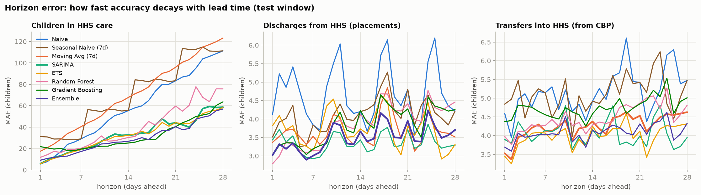

### F.3 Statistical significance

**Table F4.** Diebold–Mariano p-values against naive

| Series | h = 1 | h = 7 | h = 14 | h = 28 |
|---|---|---|---|---|
| Care load (SARIMA) | p = 0.89 | p = 0.052 | **p = 0.045** | **p < 0.001** |
| Discharges (Ensemble) | **p = 0.008** | **p = 0.003** | p = 0.072 | p = 0.29 |
| Transfers (Moving Avg) | **p = 0.035** | p = 0.12 | p = 0.059 | p = 0.58 |

For the care load, persistence is unbeatable at one day (tomorrow ≈ today), but the gains become significant at two and four weeks, the horizons that matter for capacity. For flows the gains are significant at short horizons.

**Full test output (executed notebook output).**

```
         target         champion   h  MAE champion  MAE naive  DM stat  p-value  significant (5%)
0      hhs_care           SARIMA   1         5.799      5.723    0.137    0.892             False
1      hhs_care           SARIMA   7        19.192     29.000   -1.990    0.052             False
2      hhs_care           SARIMA  14        32.498     55.480   -2.061    0.045              True
3      hhs_care           SARIMA  28        58.643    111.238  -20.918    0.000              True
4    discharged         Ensemble   1         3.021      4.128   -2.793    0.008              True
5    discharged         Ensemble   7         3.005      3.836   -3.056    0.003              True
6    discharged         Ensemble  14         3.664      4.200   -1.837    0.072             False
7    discharged         Ensemble  28         3.703      4.214   -1.066    0.292             False
8   transferred  Moving Avg (7d)   1         3.527      4.596   -2.176    0.035              True
9   transferred  Moving Avg (7d)   7         4.127      5.145   -1.588    0.118             False
10  transferred  Moving Avg (7d)  14         4.376      4.920   -1.930    0.059             False
11  transferred  Moving Avg (7d)  28         4.626      5.476   -0.563    0.577             False
```

### F.4 Robustness

**Table F5.** Robustness by series and model

| target | model | win-rate vs naive % | error growth wk4/wk1 | coverage80 % | FSI | accuracy % |
|---|---|---|---|---|---|---|
| hhs_care | Naive | n/a | 5.6 | 94.8 | 50.7 | 97.6 |
| hhs_care | Seasonal Naive (7d) | 0 | 3.8 | 94.6 | 63.5 | 97.1 |
| hhs_care | Moving Avg (7d) | 7.1 | 3.8 | 97.8 | 58.5 | 97.1 |
| hhs_care | SARIMA | 85.7 | 3.9 | 91.6 | 25.2 | 98.6 |
| hhs_care | ETS | 85.7 | 3.9 | 92.6 | 25.1 | 98.7 |
| hhs_care | Random Forest | 71.4 | 4 | 97.9 | 23.1 | 98.4 |
| hhs_care | Gradient Boosting | 92.9 | 2.7 | 100 | 33.1 | 98.7 |
| hhs_care | Ensemble | 100 | 3.7 | 97.6 | 30.2 | 98.8 |
| discharged | Naive | n/a | 1 | 95.7 | 49.9 | 53 |
| discharged | Seasonal Naive (7d) | 85.7 | 1.1 | 91.6 | 87.8 | 58.3 |
| discharged | Moving Avg (7d) | 85.7 | 1 | 94.5 | 86 | 62.9 |
| discharged | SARIMA | 85.7 | 1 | 86.2 | 87 | 65.9 |
| discharged | ETS | 78.6 | 1 | 89 | 73.7 | 62.3 |
| discharged | Random Forest | 85.7 | 1.4 | 74.2 | 87.4 | 61.2 |
| discharged | Gradient Boosting | 85.7 | 1.3 | 74.3 | 84.1 | 61.4 |
| discharged | Ensemble | 85.7 | 1.2 | 77.2 | 86.5 | 64.6 |
| transferred | Naive | n/a | 1.1 | 72.7 | 50.1 | 50.2 |
| transferred | Seasonal Naive (7d) | 50 | 1.1 | 71 | 86.6 | 50.5 |
| transferred | Moving Avg (7d) | 78.6 | 1.1 | 66 | 84.3 | 58.8 |
| transferred | SARIMA | 78.6 | 1 | 80 | 95.9 | 60.7 |
| transferred | ETS | 85.7 | 1.1 | 66.2 | 80.6 | 61.3 |
| transferred | Random Forest | 57.1 | 1.2 | 64 | 83.3 | 56.8 |
| transferred | Gradient Boosting | 50 | 1.1 | 59.5 | 82.2 | 54.1 |
| transferred | Ensemble | 64.3 | 1.1 | 68.4 | 87.6 | 60.4 |

### F.5 Interval coverage

**Table F6.** Interval coverage and width on the test window

| target | model | coverage80 | coverage95 | width80 |
|---|---|---|---|---|
| discharged | ETS | 0.89 | 0.982 | 15.223 |
| discharged | Ensemble | 0.772 | 0.963 | 11.829 |
| discharged | Gradient Boosting | 0.743 | 0.955 | 13.85 |
| discharged | Moving Avg (7d) | 0.945 | 0.99 | 16.883 |
| discharged | Naive | 0.957 | 0.996 | 21.246 |
| discharged | Random Forest | 0.742 | 0.949 | 14.925 |
| discharged | SARIMA | 0.862 | 0.988 | 12.703 |
| discharged | Seasonal Naive (7d) | 0.916 | 0.984 | 17.427 |
| hhs_care | ETS | 0.926 | 0.984 | 166.755 |
| hhs_care | Ensemble | 0.976 | 0.998 | 221.427 |
| hhs_care | Gradient Boosting | 1 | 1 | 301.447 |
| hhs_care | Moving Avg (7d) | 0.978 | 1 | 316.8 |
| hhs_care | Naive | 0.948 | 1 | 267.352 |
| hhs_care | Random Forest | 0.979 | 0.996 | 301.534 |
| hhs_care | SARIMA | 0.916 | 0.975 | 165.735 |
| hhs_care | Seasonal Naive (7d) | 0.946 | 1 | 318.754 |
| transferred | ETS | 0.662 | 0.881 | 11.29 |
| transferred | Ensemble | 0.684 | 0.907 | 11.049 |
| transferred | Gradient Boosting | 0.595 | 0.816 | 11.398 |
| transferred | Moving Avg (7d) | 0.66 | 0.843 | 11.187 |
| transferred | Naive | 0.727 | 0.908 | 13.669 |
| transferred | Random Forest | 0.64 | 0.855 | 11.67 |
| transferred | SARIMA | 0.8 | 0.958 | 12.435 |
| transferred | Seasonal Naive (7d) | 0.71 | 0.912 | 14.015 |

**Table F7.** Coverage by calibration rule

| target | model | method | coverage80 | coverage95 | width80 |
|---|---|---|---|---|---|
| discharged | ETS | fixed calibration (13 wk) | 0.89 | 0.982 | 15.223 |
| discharged | ETS | rolling origin (26 wk) | 0.878 | 0.974 | 14.403 |
| discharged | ETS | rolling origin (13 wk) | 0.824 | 0.948 | 12.426 |
| discharged | Ensemble | fixed calibration (13 wk) | 0.772 | 0.963 | 11.829 |
| discharged | Ensemble | rolling origin (26 wk) | 0.787 | 0.961 | 11.313 |
| discharged | Ensemble | rolling origin (13 wk) | 0.779 | 0.929 | 10.162 |
| discharged | Gradient Boosting | fixed calibration (13 wk) | 0.743 | 0.955 | 13.85 |
| discharged | Gradient Boosting | rolling origin (26 wk) | 0.774 | 0.95 | 13.162 |
| discharged | Gradient Boosting | rolling origin (13 wk) | 0.751 | 0.927 | 11.063 |
| discharged | Moving Avg (7d) | fixed calibration (13 wk) | 0.945 | 0.99 | 16.883 |
| discharged | Moving Avg (7d) | rolling origin (26 wk) | 0.916 | 0.987 | 15.413 |
| discharged | Moving Avg (7d) | rolling origin (13 wk) | 0.863 | 0.952 | 13.379 |
| discharged | Naive | fixed calibration (13 wk) | 0.957 | 0.996 | 21.246 |
| discharged | Naive | rolling origin (26 wk) | 0.93 | 0.995 | 19.716 |
| discharged | Naive | rolling origin (13 wk) | 0.887 | 0.971 | 17.036 |
| discharged | Random Forest | fixed calibration (13 wk) | 0.742 | 0.949 | 14.925 |
| discharged | Random Forest | rolling origin (26 wk) | 0.776 | 0.945 | 14.259 |
| discharged | Random Forest | rolling origin (13 wk) | 0.751 | 0.917 | 11.091 |
| discharged | SARIMA | fixed calibration (13 wk) | 0.862 | 0.988 | 12.703 |
| discharged | SARIMA | rolling origin (26 wk) | 0.829 | 0.978 | 11.751 |
| discharged | SARIMA | rolling origin (13 wk) | 0.777 | 0.955 | 10.154 |
| discharged | Seasonal Naive (7d) | fixed calibration (13 wk) | 0.916 | 0.984 | 17.427 |
| discharged | Seasonal Naive (7d) | rolling origin (26 wk) | 0.887 | 0.977 | 15.985 |
| discharged | Seasonal Naive (7d) | rolling origin (13 wk) | 0.851 | 0.955 | 13.671 |
| hhs_care | ETS | fixed calibration (13 wk) | 0.926 | 0.984 | 166.755 |
| hhs_care | ETS | rolling origin (26 wk) | 0.91 | 0.976 | 152.369 |
| hhs_care | ETS | rolling origin (13 wk) | 0.803 | 0.927 | 110.29 |
| hhs_care | Ensemble | fixed calibration (13 wk) | 0.976 | 0.998 | 221.427 |
| hhs_care | Ensemble | rolling origin (26 wk) | 0.965 | 0.996 | 202.119 |
| hhs_care | Ensemble | rolling origin (13 wk) | 0.851 | 0.947 | 128.25 |
| hhs_care | Gradient Boosting | fixed calibration (13 wk) | 1 | 1 | 301.447 |
| hhs_care | Gradient Boosting | rolling origin (26 wk) | 0.991 | 1 | 273.465 |
| hhs_care | Gradient Boosting | rolling origin (13 wk) | 0.794 | 0.92 | 157.935 |
| hhs_care | Moving Avg (7d) | fixed calibration (13 wk) | 0.978 | 1 | 316.8 |
| hhs_care | Moving Avg (7d) | rolling origin (26 wk) | 0.931 | 0.996 | 301.117 |
| hhs_care | Moving Avg (7d) | rolling origin (13 wk) | 0.965 | 0.996 | 166.18 |
| hhs_care | Naive | fixed calibration (13 wk) | 0.948 | 1 | 267.352 |
| hhs_care | Naive | rolling origin (26 wk) | 0.937 | 0.998 | 253.096 |
| hhs_care | Naive | rolling origin (13 wk) | 0.974 | 1 | 137.748 |
| hhs_care | Random Forest | fixed calibration (13 wk) | 0.979 | 0.996 | 301.534 |
| hhs_care | Random Forest | rolling origin (26 wk) | 0.967 | 0.996 | 268.668 |
| hhs_care | Random Forest | rolling origin (13 wk) | 0.749 | 0.888 | 170.893 |
| hhs_care | SARIMA | fixed calibration (13 wk) | 0.916 | 0.975 | 165.735 |
| hhs_care | SARIMA | rolling origin (26 wk) | 0.902 | 0.967 | 150.498 |
| hhs_care | SARIMA | rolling origin (13 wk) | 0.817 | 0.945 | 108.377 |
| hhs_care | Seasonal Naive (7d) | fixed calibration (13 wk) | 0.946 | 1 | 318.754 |
| hhs_care | Seasonal Naive (7d) | rolling origin (26 wk) | 0.911 | 0.99 | 304.149 |
| hhs_care | Seasonal Naive (7d) | rolling origin (13 wk) | 0.951 | 0.992 | 167.38 |
| transferred | ETS | fixed calibration (13 wk) | 0.662 | 0.881 | 11.29 |
| transferred | ETS | rolling origin (26 wk) | 0.7 | 0.891 | 11.747 |
| transferred | ETS | rolling origin (13 wk) | 0.707 | 0.894 | 12.11 |
| transferred | Ensemble | fixed calibration (13 wk) | 0.684 | 0.907 | 11.049 |
| transferred | Ensemble | rolling origin (26 wk) | 0.719 | 0.908 | 11.412 |
| transferred | Ensemble | rolling origin (13 wk) | 0.693 | 0.859 | 11.281 |
| transferred | Gradient Boosting | fixed calibration (13 wk) | 0.595 | 0.816 | 11.398 |
| transferred | Gradient Boosting | rolling origin (26 wk) | 0.675 | 0.848 | 12.038 |
| transferred | Gradient Boosting | rolling origin (13 wk) | 0.641 | 0.811 | 12.009 |
| transferred | Moving Avg (7d) | fixed calibration (13 wk) | 0.66 | 0.843 | 11.187 |
| transferred | Moving Avg (7d) | rolling origin (26 wk) | 0.684 | 0.861 | 11.58 |
| transferred | Moving Avg (7d) | rolling origin (13 wk) | 0.711 | 0.868 | 12.285 |
| transferred | Naive | fixed calibration (13 wk) | 0.727 | 0.908 | 13.669 |
| transferred | Naive | rolling origin (26 wk) | 0.736 | 0.904 | 14.144 |
| transferred | Naive | rolling origin (13 wk) | 0.76 | 0.943 | 15.501 |
| transferred | Random Forest | fixed calibration (13 wk) | 0.64 | 0.855 | 11.67 |
| transferred | Random Forest | rolling origin (26 wk) | 0.689 | 0.88 | 12.126 |
| transferred | Random Forest | rolling origin (13 wk) | 0.652 | 0.834 | 11.803 |
| transferred | SARIMA | fixed calibration (13 wk) | 0.8 | 0.958 | 12.435 |
| transferred | SARIMA | rolling origin (26 wk) | 0.815 | 0.962 | 12.932 |
| transferred | SARIMA | rolling origin (13 wk) | 0.737 | 0.945 | 12.104 |
| transferred | Seasonal Naive (7d) | fixed calibration (13 wk) | 0.71 | 0.912 | 14.015 |
| transferred | Seasonal Naive (7d) | rolling origin (26 wk) | 0.729 | 0.887 | 14.088 |
| transferred | Seasonal Naive (7d) | rolling origin (13 wk) | 0.756 | 0.92 | 15.531 |

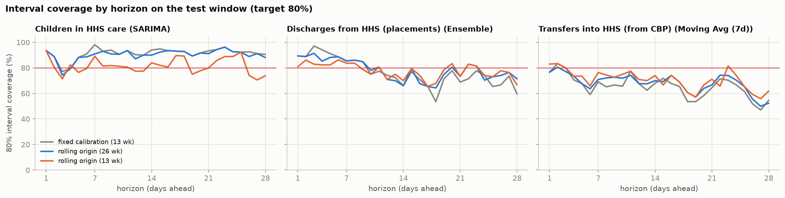

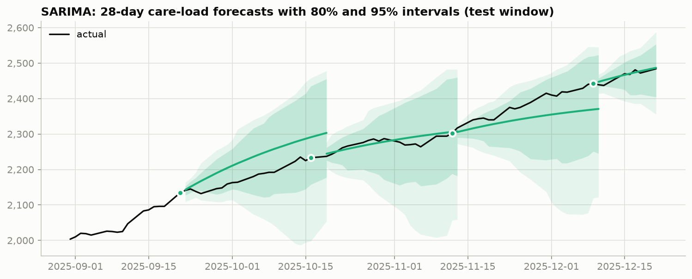

### F.6 Early warning

**Table F8.** Early-warning operating curve

| alert at P(breach) ≥ | events | detected % | median lead (days) | mean lead (days) | false alarms % | source |
|---|---|---|---|---|---|---|
| 0.5 | 25 | 80 | 1 | 2.4 | 12.4 | replay 2023–24 |
| 0.4 | 25 | 100 | 6 | 6.1 | 15.1 | replay 2023–24 |
| 0.3 | 25 | 100 | 14 | 14.6 | 25.7 | replay 2023–24 |
| 0.2 | 25 | 100 | 27 | 21.8 | 35.6 | replay 2023–24 |
| 0.1 | 25 | 100 | 28 | 24.4 | 43.1 | replay 2023–24 |
| 0.5 | 16 | 100 | 18.5 | 17.9 | 16 | test 2025 |
| 0.4 | 16 | 100 | 23.5 | 22.4 | 20.5 | test 2025 |
| 0.3 | 16 | 100 | 28 | 24.3 | 22.4 | test 2025 |
| 0.2 | 16 | 100 | 28 | 25.4 | 23.9 | test 2025 |
| 0.1 | 16 | 100 | 28 | 26.9 | 24.8 | test 2025 |

**Table F9.** Lead time of every surge event at the 30% alert level

| threshold | event_date | lead_days | detected | source |
|---|---|---|---|---|
| 6,000 | 2023-06-29 | 9 | True | replay 2023–24 |
| 6,000 | 2024-12-02 | 6 | True | replay 2023–24 |
| 6,500 | 2023-07-12 | 16 | True | replay 2023–24 |
| 6,500 | 2024-12-17 | 14 | True | replay 2023–24 |
| 7,000 | 2023-07-19 | 13 | True | replay 2023–24 |
| 7,000 | 2024-04-24 | 10 | True | replay 2023–24 |
| 7,500 | 2023-07-25 | 8 | True | replay 2023–24 |
| 7,500 | 2024-05-01 | 17 | True | replay 2023–24 |
| 7,500 | 2024-05-30 | 28 | True | replay 2023–24 |
| 8,000 | 2023-03-21 | 7 | True | replay 2023–24 |
| 8,000 | 2023-04-25 | 1 | True | replay 2023–24 |
| 8,000 | 2023-08-01 | 14 | True | replay 2023–24 |
| 8,500 | 2023-05-02 | 6 | True | replay 2023–24 |
| 8,500 | 2023-08-08 | 15 | True | replay 2023–24 |
| 8,500 | 2024-02-14 | 10 | True | replay 2023–24 |
| 9,000 | 2023-08-16 | 16 | True | replay 2023–24 |
| 9,500 | 2023-08-16 | 15 | True | replay 2023–24 |
| 9,500 | 2023-11-08 | 9 | True | replay 2023–24 |
| 10,000 | 2023-08-23 | 22 | True | replay 2023–24 |
| 10,000 | 2023-11-27 | 26 | True | replay 2023–24 |
| 10,500 | 2023-09-12 | 22 | True | replay 2023–24 |
| 10,500 | 2023-11-30 | 28 | True | replay 2023–24 |
| 11,000 | 2023-09-19 | 14 | True | replay 2023–24 |
| 11,000 | 2023-12-12 | 16 | True | replay 2023–24 |
| 11,500 | 2023-12-20 | 23 | True | replay 2023–24 |
| 2,100 | 2025-09-21 | 20 | True | test 2025 |
| 2,125 | 2025-09-21 | 20 | True | test 2025 |
| 2,150 | 2025-09-30 | 20 | True | test 2025 |
| 2,175 | 2025-10-05 | 24 | True | test 2025 |
| 2,200 | 2025-10-13 | 28 | True | test 2025 |
| 2,225 | 2025-10-14 | 28 | True | test 2025 |
| 2,250 | 2025-10-21 | 28 | True | test 2025 |
| 2,275 | 2025-10-26 | 28 | True | test 2025 |
| 2,300 | 2025-11-12 | 28 | True | test 2025 |
| 2,325 | 2025-11-16 | 28 | True | test 2025 |
| 2,350 | 2025-11-23 | 14 | True | test 2025 |
| 2,375 | 2025-11-27 | 18 | True | test 2025 |
| 2,400 | 2025-11-30 | 21 | True | test 2025 |
| 2,425 | 2025-12-07 | 28 | True | test 2025 |
| 2,450 | 2025-12-14 | 28 | True | test 2025 |
| 2,475 | 2025-12-17 | 28 | True | test 2025 |

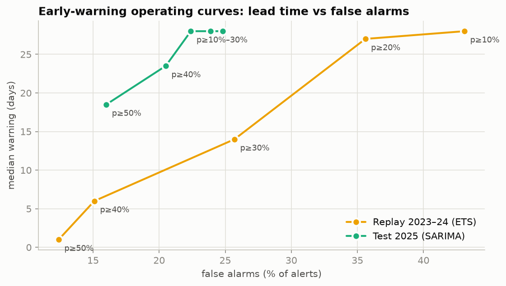

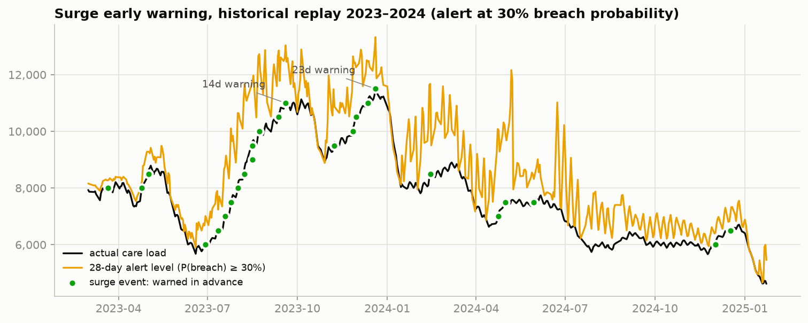

### F.7 Production forecast and scenarios

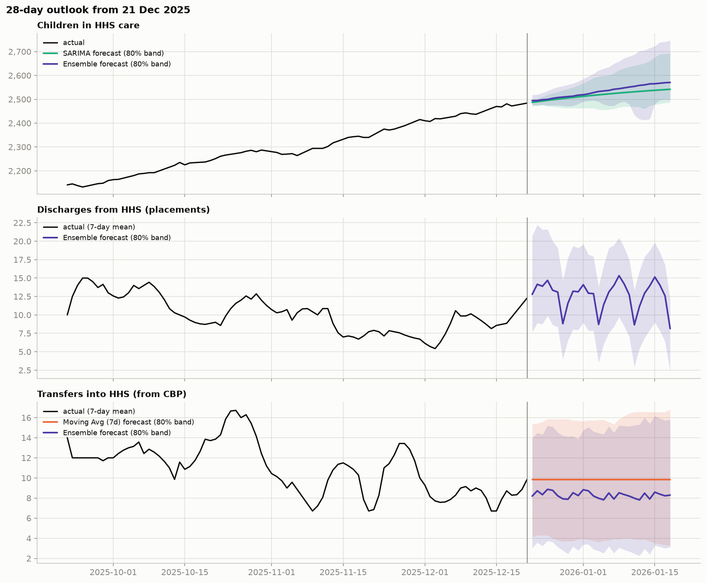

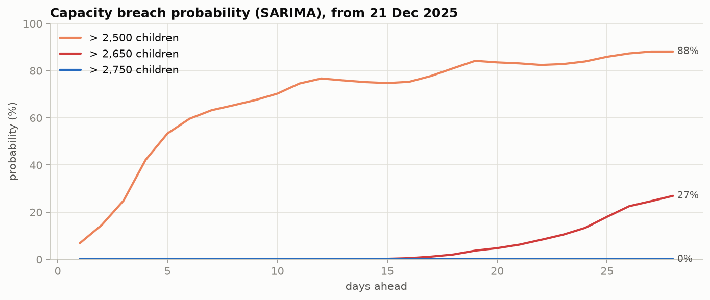

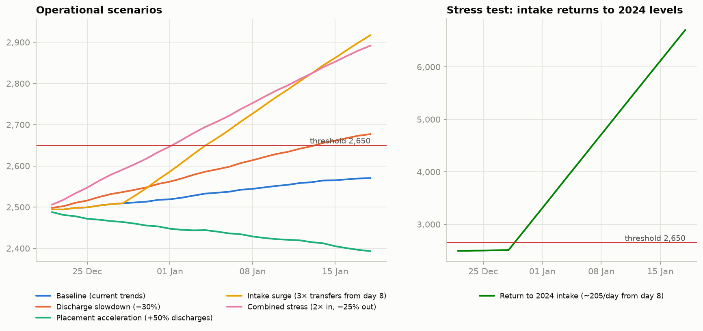

### F.8 Pipeline analytics

**Table F10.** Indicators by period

| Period | Indicator | Reports evaluated | % Watch or Alert | % Alert | Median value | Max value | Unit |
|---|---|---|---|---|---|---|---|
| Before the break | HHS census growth (backlog building) | 245 | 21.63 | 6.53 | -0.86 | 16.44 | % vs 28 days earlier |
| Before the break | Discharge slowdown (placement bottleneck) | 245 | 10.61 | 0.41 | 2.21 | 33.62 | % below 8-week median rate |
| Before the break | CBP holding time (transfer bottleneck) | 243 | 0 | 0 | 1.31 | 1.85 | days (custody / transfers, 7-day) |
| Current regime | HHS census growth (backlog building) | 185 | 42.16 | 0 | 4.46 | 8.68 | % vs 28 days earlier |
| Current regime | Discharge slowdown (placement bottleneck) | 183 | 42.62 | 22.4 | 10.01 | 87.41 | % below 8-week median rate |
| Current regime | CBP holding time (transfer bottleneck) | 183 | 95.63 | 43.72 | 2.88 | 6.57 | days (custody / transfers, 7-day) |
| Last 90 days | HHS census growth (backlog building) | 61 | 63.93 | 0 | 5.88 | 8.25 | % vs 28 days earlier |
| Last 90 days | Discharge slowdown (placement bottleneck) | 61 | 44.26 | 21.31 | 13.28 | 46.79 | % below 8-week median rate |
| Last 90 days | CBP holding time (transfer bottleneck) | 61 | 100 | 60.66 | 3.19 | 6.57 | days (custody / transfers, 7-day) |

**Table F11.** Share of reported days by overall status and year (%)

| Year | Normal | Watch | Alert | Insufficient data | HHS census growth (backlog building) at Watch or Alert | Discharge slowdown (placement bottleneck) at Watch or Alert | CBP holding time (transfer bottleneck) at Watch or Alert |
|---|---|---|---|---|---|---|---|
| 2023 | 45.7 | 14.3 | 33.9 | 6.1 | 50 | 5.3 | n/a |
| 2024 | 70.6 | 22.6 | 6.9 | 0 | 21.4 | 10.5 | 0 |
| 2025 | 16 | 30.4 | 53.6 | 0 | 32.9 | 41.7 | 79.6 |

**Table F12.** Every Watch and Alert episode, full history

| Indicator | Start | End | Reported days | Calendar days | Highest level | Peak value | Unit |
|---|---|---|---|---|---|---|---|
| HHS census growth (backlog building) | 2023-02-09 | 2023-02-22 | 9 | 14 | Alert | 20.44 | % vs 28 days earlier |
| HHS census growth (backlog building) | 2023-04-06 | 2023-04-06 | 1 | 1 | Watch | 5.03 | % vs 28 days earlier |
| HHS census growth (backlog building) | 2023-05-01 | 2023-05-18 | 14 | 18 | Alert | 16.71 | % vs 28 days earlier |
| HHS census growth (backlog building) | 2023-07-10 | 2023-09-28 | 55 | 81 | Alert | 37.61 | % vs 28 days earlier |
| HHS census growth (backlog building) | 2023-10-02 | 2023-10-05 | 4 | 4 | Watch | 7.37 | % vs 28 days earlier |
| HHS census growth (backlog building) | 2023-11-23 | 2023-12-28 | 25 | 36 | Alert | 17.46 | % vs 28 days earlier |
| HHS census growth (backlog building) | 2024-02-14 | 2024-02-15 | 2 | 2 | Watch | 5.45 | % vs 28 days earlier |
| HHS census growth (backlog building) | 2024-02-22 | 2024-02-22 | 1 | 1 | Watch | 5.22 | % vs 28 days earlier |
| HHS census growth (backlog building) | 2024-02-27 | 2024-03-12 | 11 | 15 | Alert | 10.01 | % vs 28 days earlier |
| HHS census growth (backlog building) | 2024-05-05 | 2024-05-21 | 13 | 17 | Alert | 12.88 | % vs 28 days earlier |
| HHS census growth (backlog building) | 2024-09-04 | 2024-09-16 | 10 | 13 | Watch | 7.89 | % vs 28 days earlier |
| HHS census growth (backlog building) | 2024-12-09 | 2024-12-30 | 16 | 22 | Alert | 16.44 | % vs 28 days earlier |
| HHS census growth (backlog building) | 2025-04-07 | 2025-04-29 | 18 | 23 | Watch | 8.39 | % vs 28 days earlier |
| HHS census growth (backlog building) | 2025-05-15 | 2025-06-09 | 15 | 26 | Watch | 8.68 | % vs 28 days earlier |
| HHS census growth (backlog building) | 2025-09-15 | 2025-10-16 | 23 | 32 | Watch | 8.25 | % vs 28 days earlier |
| HHS census growth (backlog building) | 2025-10-22 | 2025-10-30 | 7 | 9 | Watch | 6.29 | % vs 28 days earlier |
| HHS census growth (backlog building) | 2025-11-30 | 2025-12-18 | 15 | 19 | Watch | 6.8 | % vs 28 days earlier |
| Discharge slowdown (placement bottleneck) | 2023-06-22 | 2023-06-22 | 1 | 1 | Watch | 21.68 | % below 8-week median rate |
| Discharge slowdown (placement bottleneck) | 2023-07-09 | 2023-07-12 | 4 | 4 | Watch | 20.26 | % below 8-week median rate |
| Discharge slowdown (placement bottleneck) | 2023-10-12 | 2023-10-12 | 1 | 1 | Watch | 16.84 | % below 8-week median rate |
| Discharge slowdown (placement bottleneck) | 2023-11-27 | 2023-12-03 | 5 | 7 | Watch | 24.24 | % below 8-week median rate |
| Discharge slowdown (placement bottleneck) | 2024-02-19 | 2024-02-19 | 1 | 1 | Watch | 17.08 | % below 8-week median rate |
| Discharge slowdown (placement bottleneck) | 2024-02-22 | 2024-02-22 | 1 | 1 | Watch | 15.66 | % below 8-week median rate |
| Discharge slowdown (placement bottleneck) | 2024-04-29 | 2024-05-02 | 4 | 4 | Watch | 18.27 | % below 8-week median rate |
| Discharge slowdown (placement bottleneck) | 2024-05-27 | 2024-05-27 | 1 | 1 | Watch | 15.08 | % below 8-week median rate |
| Discharge slowdown (placement bottleneck) | 2024-05-29 | 2024-05-30 | 2 | 2 | Watch | 25.32 | % below 8-week median rate |
| Discharge slowdown (placement bottleneck) | 2024-07-11 | 2024-07-11 | 1 | 1 | Watch | 16.54 | % below 8-week median rate |
| Discharge slowdown (placement bottleneck) | 2024-08-04 | 2024-08-06 | 3 | 3 | Watch | 20.39 | % below 8-week median rate |
| Discharge slowdown (placement bottleneck) | 2024-08-27 | 2024-09-10 | 10 | 15 | Alert | 33.62 | % below 8-week median rate |
| Discharge slowdown (placement bottleneck) | 2024-12-04 | 2024-12-08 | 3 | 5 | Watch | 18.98 | % below 8-week median rate |
| Discharge slowdown (placement bottleneck) | 2025-02-17 | 2025-04-20 | 45 | 63 | Alert | 87.41 | % below 8-week median rate |
| Discharge slowdown (placement bottleneck) | 2025-07-31 | 2025-08-07 | 6 | 8 | Watch | 20.97 | % below 8-week median rate |
| Discharge slowdown (placement bottleneck) | 2025-08-17 | 2025-08-25 | 7 | 9 | Alert | 32.78 | % below 8-week median rate |
| Discharge slowdown (placement bottleneck) | 2025-09-03 | 2025-09-09 | 5 | 7 | Alert | 36.41 | % below 8-week median rate |
| Discharge slowdown (placement bottleneck) | 2025-09-11 | 2025-09-22 | 8 | 12 | Watch | 29.23 | % below 8-week median rate |
| Discharge slowdown (placement bottleneck) | 2025-10-15 | 2025-10-23 | 7 | 9 | Alert | 31.24 | % below 8-week median rate |
| Discharge slowdown (placement bottleneck) | 2025-11-05 | 2025-11-05 | 1 | 1 | Watch | 20.95 | % below 8-week median rate |
| Discharge slowdown (placement bottleneck) | 2025-11-13 | 2025-12-04 | 15 | 22 | Alert | 46.79 | % below 8-week median rate |
| Discharge slowdown (placement bottleneck) | 2025-12-08 | 2025-12-09 | 2 | 2 | Watch | 17.41 | % below 8-week median rate |
| Discharge slowdown (placement bottleneck) | 2025-12-14 | 2025-12-15 | 2 | 2 | Watch | 21.9 | % below 8-week median rate |
| CBP holding time (transfer bottleneck) | 2025-02-26 | 2025-02-26 | 1 | 1 | Watch | 2.02 | days (custody / transfers, 7-day) |
| CBP holding time (transfer bottleneck) | 2025-03-02 | 2025-03-24 | 17 | 23 | Alert | 3.8 | days (custody / transfers, 7-day) |
| CBP holding time (transfer bottleneck) | 2025-03-31 | 2025-05-08 | 30 | 39 | Alert | 3.11 | days (custody / transfers, 7-day) |
| CBP holding time (transfer bottleneck) | 2025-05-15 | 2025-06-08 | 14 | 25 | Alert | 3.3 | days (custody / transfers, 7-day) |
| CBP holding time (transfer bottleneck) | 2025-06-10 | 2025-06-10 | 1 | 1 | Watch | 2.14 | days (custody / transfers, 7-day) |
| CBP holding time (transfer bottleneck) | 2025-06-22 | 2025-08-28 | 48 | 68 | Alert | 5.38 | days (custody / transfers, 7-day) |
| CBP holding time (transfer bottleneck) | 2025-09-02 | 2025-12-21 | 76 | 111 | Alert | 6.57 | days (custody / transfers, 7-day) |

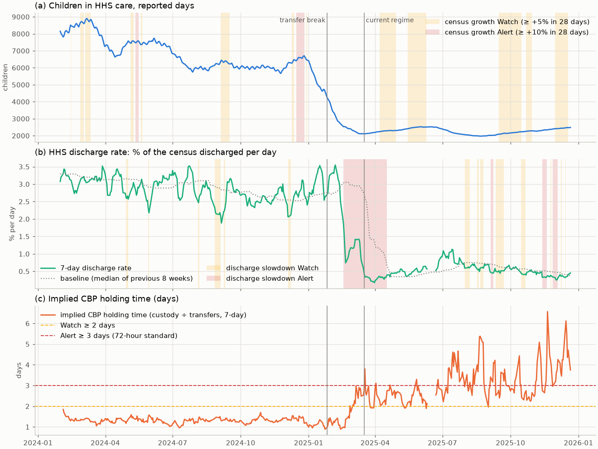

## Appendix G. Software Validation and Reproducibility

This appendix explains how the work was tested and how to reproduce it.

### G.1 Software validation

The notebook executes top to bottom in a clean kernel (205 cells, 0 errors, 8–26 minutes depending on machine load). An automated suite, organised into eight pytest categories (data validation, preprocessing and features, model units, forecast and metrics, integration, Streamlit application, end-to-end workflow, performance and reliability), executes the notebook's own code and the real dashboard script, including edge cases on synthetic files (empty, malformed, constant, short, weekly, out-of-range inputs; failing and invalid models; missing dependencies; corrupted artifacts). The Streamlit dashboard was also exercised in a real browser. Pass/fail counts, open defects and evidence are in `reports/Test_Report_v2.md`; this paper does not restate them, to keep a single source of truth.

A fast pytest suite in `tests/` (`python -m pytest`) covers the descriptive pipeline layer of Section 8 of the paper:

- data ingestion and validation, including a cell-by-cell reconciliation of the cleaned table with the raw export;
- KPI and aggregation definitions, checked against hand-computed examples and an independent recomputation from the raw file;
- the alert rules, at their threshold boundaries, with a no-look-ahead truncation test;
- the dashboard's controls, empty and invalid ranges, file handling and a real server start-up;
- the consistency of this paper, the executive summary and the README with the generated values.

Results are in `reports/Test_Report_v2.1.md`.

A separate end-to-end QA run is reported in reports/QA_Test_Execution_Report_v2.3.pdf.

### G.2 Where everything is

**Table G1.** Reproducibility: where each result lives

| Item | Location |
|---|---|
| Full executed analysis | `UAC_Care_Load_Forecasting.ipynb` (8–26 minutes in a clean kernel; deterministic seeds; editable source `notebook_source/UAC_Care_Load_Forecasting_v2.py`) |
| Interactive dashboard | `python -m streamlit run uac_forecast_dashboard.py` |
| Clean daily data with masks | `artifacts/daily_clean.csv` |
| Walk-forward forecasts (scored) | `artifacts/backtest.csv.gz` |
| Metrics, coverage, robustness | `artifacts/metrics_overall.csv`, `metrics_by_horizon.csv`, `interval_coverage.csv`, `interval_coverage_by_h.csv`, `interval_method_comparison.csv`, `robustness.csv` |
| Validation and audit | `artifacts/validation_report.csv`, `model_fit_log.csv`, `feature_leakage_audit.csv` |
| Production forecasts with intervals | `artifacts/forecast_future.csv` |
| Early-warning results | `artifacts/surge_lead_times.csv`, `ews_operating_curve.csv`, `surge_replay_paths.csv` |
| Run metadata | `artifacts/metadata.json` |
| Tests and test report | `QA_Testing/pytest_suite/`, `reports/Test_Report_v2.md` |
| Pipeline analytics (Section 8 of the paper) | `src/` (functions), `python tools/pipeline_analysis.py` (regenerates `reports/pipeline_*.csv`, `reports/pipeline_analysis.md` and the notebook-size pipeline chart) |
| Pipeline and consistency tests | `python -m pytest` (suite in `tests/`), results in `reports/Test_Report_v2.1.md` |

**Table G2.** Rebuilding this paper

| Item | Command |
|---|---|
| Main-body charts | `python tools/paper_figures.py` |
| This Appendix volume (Markdown) | `python tools/build_paper_appendix.py` |
| Word and PDF of both documents, then all quality checks | `python tools/build_paper.py` |
| Quality checks only | `python tools/check_paper.py` |

<!-- landscape -->

## Appendix H. Raw Source Code

This appendix reproduces all source code as it stood when this volume was built. Long lines wrap.

### H.1 Analysis notebook source: notebook_source/UAC_Care_Load_Forecasting_v2.py

<!-- code: notebook_source/UAC_Care_Load_Forecasting_v2.py -->

### H.2 Streamlit dashboard: uac_forecast_dashboard.py

<!-- code: uac_forecast_dashboard.py -->

### H.3 Data loading: src/data_loader.py

<!-- code: src/data_loader.py -->

### H.4 KPI calculations: src/kpi_calculations.py

<!-- code: src/kpi_calculations.py -->

### H.5 Bottleneck detection: src/bottleneck_detection.py

<!-- code: src/bottleneck_detection.py -->

### H.6 Chart helpers: src/visualizations.py

<!-- code: src/visualizations.py -->

### H.7 Pipeline analysis script: tools/pipeline_analysis.py

<!-- code: tools/pipeline_analysis.py -->

### H.8 Paper figure script: tools/paper_figures.py

<!-- code: tools/paper_figures.py -->
