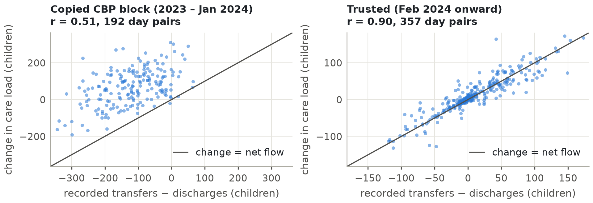
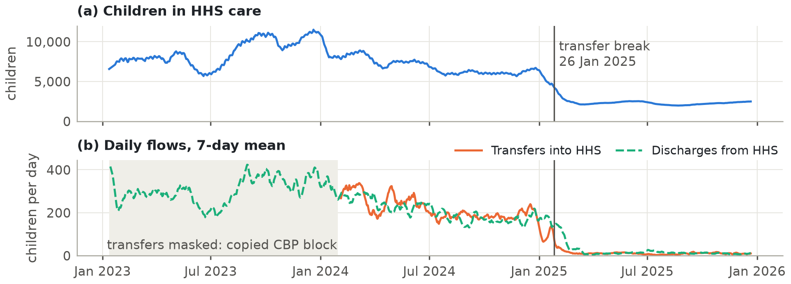
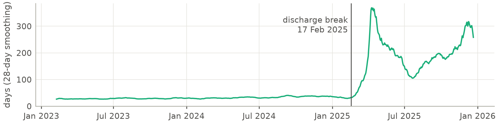
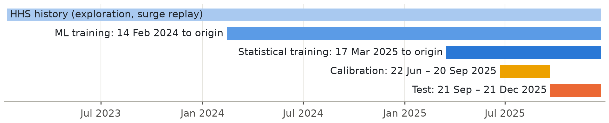
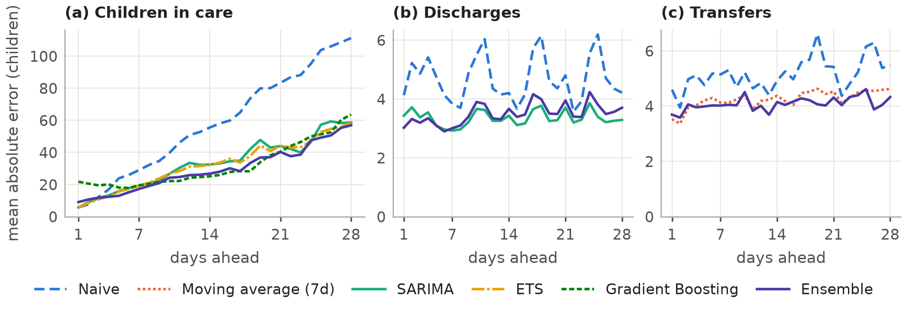
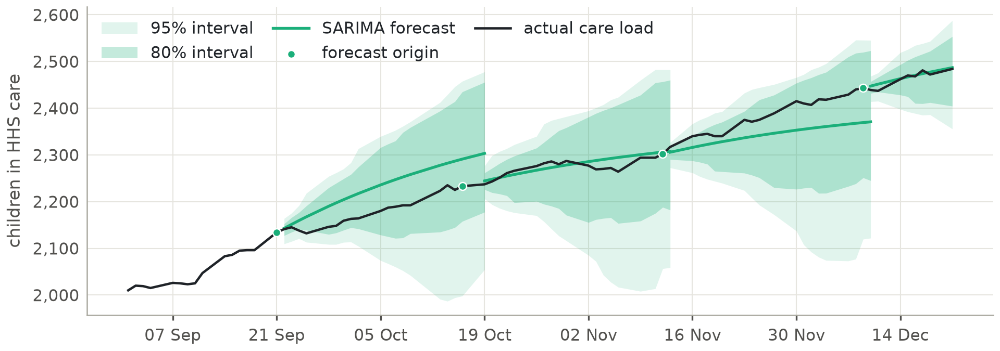
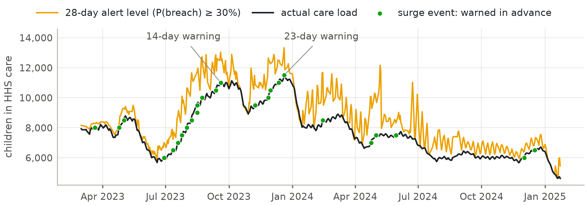
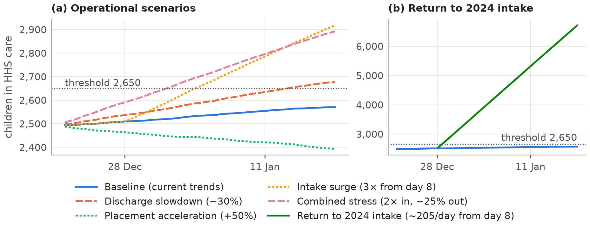
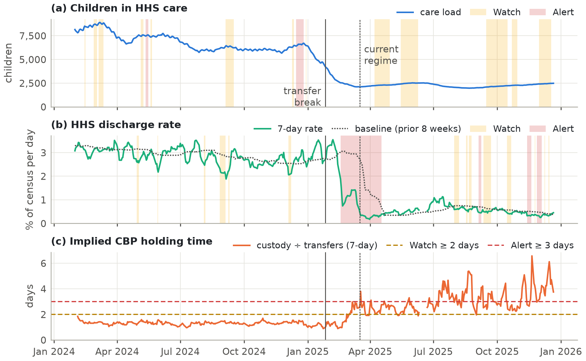

# Forecasting Care Load and Placement Demand in the HHS Unaccompanied Children Program

**A regime-aware, walk-forward-validated early-warning approach**

Unified Mentor Data Science Internship, October 2026. Data: HHS Unaccompanied Alien Children (UAC) Program daily reports, 12 January 2023 to 21 December 2025.

## Abstract

The Office of Refugee Resettlement (ORR) cares for unaccompanied children transferred from U.S. Customs and Border Protection (CBP) until they can be released to a sponsor. Planners need to know how many children will be in care in the coming weeks, whether placements will keep pace with arrivals, and when to scale shelters and staff. This study builds and evaluates a forecasting and early-warning system on three years of daily program data.

A data audit came first. It found that 251 CBP reports (12 January 2023 to 30 January 2024) are copies of later dates and that Fridays and Saturdays are almost never reported. The program also changed regime in early 2025: intake fell about 95% and the implied length of stay rose from about 36 to about 203 days.

Eight forecasting approaches were compared by walk-forward validation. Champions were chosen on a calibration window and reported on an untouched test window. The care-load champion (SARIMA) is 98.6% accurate, with a mean absolute error of 32 children, 43% below a naive forecast. In a real-time replay of 2023–24 with a simpler model, a 30% breach-probability alert detected all 25 surge events, with a median **14-day** warning. The champion's intake intervals remain too narrow (66–71% coverage against an 80% target).

A monitoring layer shows the HHS discharge rate falling from 2.88% of the census per day before the break to 0.52% in the current regime (0.44% in the last 90 days). The implied CBP holding time rose from 1.32 to 2.96 days and reached the 3-day level on 44% of current-regime reports. This is an indicative signal, not a measured custody time, and it needs confirmation. The outlook is slow growth: 2,542 children by 18 January 2026 (80% interval 2,486–2,694). Placement capacity, especially at weekends, is the main lever for planners.

## 1. Introduction

The UAC Program operates under high uncertainty. Border activity, enforcement policy and humanitarian crises can change the number of children entering federal care within weeks. Licensed beds, case managers and clinicians take weeks to scale. Descriptive reports show what happened yesterday; they do not show what is coming.

**Problem statement.** Using only the published daily reports, forecast the number of children in HHS care, daily discharges and transfers, and the imbalance between them, for 1–28 days ahead. Quantify the uncertainty, provide an early-warning rule, and show by honest out-of-sample testing how reliable each forecast is.

**Objectives.**

1. Forecast the number of children in HHS care 1–28 days ahead.
2. Estimate the future imbalance between intake (transfers in) and exits (discharges to sponsors).
3. Predict short-term discharge (placement) demand.
4. Provide early warnings with quantified uncertainty.
5. Compare statistical and machine-learning approaches, and evaluate reliability across horizons.

**Main contribution.** Data-quality analysis and leakage control changed the conclusions. A naive pipeline on this file would have trained on copied intake records, let future values leak into its features, and learned a structural break as "January seasonality" (Section 4.2).

## 2. Data and Data Quality

This section describes the source file, tests whether it can be trusted, and records how each problem was treated.

### 2.1 Methodology

Two validation layers run before any analysis. Schema checks stop a malformed file with a clear message. Plausibility checks set impossible values to missing and list them; they never replace them with zero. Audits then tested the reporting calendar, repeated values and duplicate CBP records. Finally, the stock-flow identity served as a truth test: the daily change in children in care should equal transfers in minus discharges out. On the real file, every validation check passes and nothing is quarantined.

### 2.2 Dataset

The file has 1,170 rows below its header: 720 daily reports and 450 blank padding rows. Table 1 lists the fields. Stocks are point-in-time levels and flows are daily counts. A stock must reconcile with its flows, and that became the main data-quality test. The file has no columns for non-CBP admissions, other exits or bed capacity, so every capacity threshold in this study is a user input or an illustration.

**Table 1.** Fields in the source file

| Field | Meaning | Type |
|---|---|---|
| Children apprehended and placed in CBP custody | CBP intake | Daily count (flow) |
| Children in CBP custody | CBP care load | Snapshot (stock) |
| Children transferred out of CBP custody | Flow into HHS | Daily count (flow) |
| Children in HHS care | HHS care load | Snapshot (stock) |
| Children discharged from HHS care | Sponsor placements | Daily count (flow) |

### 2.3 Findings

- **Reporting cadence.** Reports arrive Sunday to Thursday. In three years there are only 2 Friday reports and none on a Saturday. About a third of calendar days (355 of 1,075) have no report, so missing days are structural, not random.
- **Stale reports.** Five reports repeat the previous report's care load and discharges exactly. They were set to missing and never used as scored targets.
- **Copied CBP records (the key finding).** A block of 251 reports from 12 Jan 2023 to 30 Jan 2024 copies CBP values from later dates. For example, the values (56, 82, 68) appear on five dates, each time beside a completely different HHS care load. Table 2 and Figure 1 give the proof: the stock-flow identity breaks in the copied block and holds afterwards.
- **Flows do not fully explain the stock.** Even in trusted data, care load rises about 3 children a day more than recorded transfers minus discharges. This suggests admissions from outside CBP or a definitional difference. It is carried as a measured term (+3.35 children/day over the last 60 days), not modelled as a flow.

**Table 2.** Stock-flow identity test: change in care load against recorded net flow

| Period | Day pairs | Correlation | Mean residual (children per day) |
|---|---|---|---|
| Copied CBP block (2023 – Jan 2024) | 192 | **0.51** | **+190** |
| Trusted (Feb 2024 onward) | 357 | **0.90** | +2.6 |

{width=6.4}

### 2.4 Treatment

Table 3 summarises the decisions. Interpolation was tested before it was used. In the current regime, Sunday counts are single-day counts, not 3-day totals (7.2 discharges against 12.8 on Monday–Thursday), and interpolated weekend flows reconcile with the stock to within about 0.45 children a day. Zero-filling was rejected because the stock keeps moving over weekends. The copy detection was re-run with only the data available at the first forecast origin (22 June 2025) and gave the identical block, so these masks would have been available in real time.

**Table 3.** Data-quality decisions

| Issue | Treatment |
|---|---|
| 450 blank rows; text dates and numbers; reverse order | Dropped, parsed, typed and sorted |
| Friday and Saturday missing | Daily calendar with time interpolation, plus a mask of genuine reports |
| 5 stale HHS reports | Set to missing, interpolated, never scored |
| Copied CBP block | CBP fields masked; machine-learning models use trusted data only |
| HHS columns | Kept for the full history; they reconcile wherever they can be checked |

**Leakage guard.** An interpolated Friday value is computed from the following Sunday, so a forecast issued "as of Friday" would secretly know Sunday. Every forecast is therefore issued from a reported day and scored only on reported days.

**Why it matters.** A model trained on the raw file would have learned from a year of false intake data.

## 3. Exploratory Data Analysis

This section asks what drives the care load and what a forecasting model must respect.

### 3.1 Methodology

Change points were located with single-split least-squares segmentation on log flows (Truong et al., 2020). Average length of stay comes from Little's law: children in care divided by daily discharges (Little, 1961). Seasonality was examined with STL decomposition (Cleveland et al., 1990) and stationarity with the ADF and KPSS tests (Dickey & Fuller, 1979; Kwiatkowski et al., 1992). Outliers were screened with robust z-scores against a centred 29-day median.

### 3.2 A structural break in early 2025

The break falls on 26 Jan 2025 for transfers and on 17 Feb 2025 for discharges. The current regime is dated from 17 Mar 2025, four weeks later, to let the backlog drain. Table 4 and Figure 2 show the scale of the change.

**Table 4.** Daily averages before and after the break

| Average per day | Feb 2024 – break | Current regime | Change |
|---|---|---|---|
| Apprehended (CBP intake) | 146.0 | 7.8 | −94.7% |
| Transfers into HHS | 209.9 | 9.6 | −95.4% |
| Discharges from HHS | 203.2 | 11.7 | −94.3% |
| Children in HHS care | 6,751 | 2,262 | −66.5% |

{width=6.4}

### 3.3 The bottleneck moved from intake to placement

Implied length of stay rose from about 36 days before the break to about 203 days in the current regime (Figure 3). The program shrank, but placements shrank faster than the caseload. Net pressure (transfers minus discharges) explains the shape of the curve: net outflow of up to 19 children a day in mid-July drove the June–August 2025 drawdown (about 2,500 to 1,972). Small recorded net inflows since September (about +1 a day) explain only part of the later climb.

{width=6.4}

**Why it matters.** Care load now responds mainly to the pace of discharges, so placement capacity is the primary planning lever.

### 3.4 The weekend ratchet

In the current regime, discharges peak mid-week (Thursday 14.9, Wednesday 13.5) and are lowest on Sundays (7.2). Transfers are flatter (8.7–10.8). Table 5 compares care-load changes on weekdays with changes across the unreported weekend gap.

**Table 5.** Care-load change per day: weekdays against the Thursday-to-Sunday gap

| Period | Weekday change per day | Weekend change per day |
|---|---|---|
| 2023 – Jan 2024 | +66.8 | −76.6 |
| Feb 2024 – break | +19.4 | −64.5 |
| **Current regime** | **−0.3** | **+3.4** |

Over the current regime, care load rose by 373. Weekday transitions netted −40, Thursday-to-Sunday gaps +323, and other multi-day reporting gaps +90. Net growth has come across weekends, when arrivals continue but placements slow. This is inferred from stock changes, because Friday and Saturday flows are almost never reported.

### 3.5 Other patterns

- **No stable monthly pattern.** Month-to-month direction agreed between 2023 and 2024 in only 5 of 11 months. Month effects cannot be estimated from this history.
- **Weekly seasonality.** In the current regime, weekly seasonal strength is 0.42 for discharges but only 0.14 for care load.
- **Stationarity.** Care load is modelled with one difference, because a stock accumulates its flows. Discharges are modelled in logs with a constant, so forecasts revert to the regime's typical level.
- **Surges and outliers.** The fastest 28-day rises were all in 2023, up to +37.6% on reported days (to 16 Aug 2023). The largest outlier, 29 transfers on 11 Sep 2025 against a local median of 11, passes the plausibility rules and is kept.
- **Correlations (associations, not causes).** In the current regime, daily care-load change rises with transfers (+0.47) and falls with discharges (−0.61). Transfers correlate 0.59 and 0.58 with apprehensions one and two days earlier, against 0.38 on the same day, so CBP intake leads HHS transfers by one to two days.

## 4. Feature Engineering

This section explains which inputs the machine-learning (ML) models use and how they were checked for leakage.

### 4.1 Methodology

All features use only information available at the end of the forecast origin day. The ML models use a direct multi-horizon design: one row per origin and horizon (1–28 days), so one model learns all horizons and never needs future values as inputs. The 2024 and 2025 regimes differ twentyfold in volume, so ML targets are scale-free log ratios. Table 6 summarises the 40 features.

**Table 6.** Feature groups

| Group | Features |
|---|---|
| Lags (1, 7, 14 days) | Care-load log-changes; flow lags relative to their 14-day mean |
| Rolling mean and variance (7, 14 days) | Care-load deviation from rolling mean; rolling volatility; flow rolling means |
| Flow-based signals | Net pressure per 100 children; CBP pipeline per 100 children; flow rates |
| Calendar | Target weekday, US federal-holiday window, origin weekday, horizon |
| Seasonal anchor | Same weekday last week relative to today's level |

### 4.2 Feature selection and leakage audit

No automated selection algorithm was used. One feature was removed on evidence of confounding. The target month became the top care-load feature (about 30% of Random Forest importance) and created a 10% forecast cliff at the month boundary. The trusted history contains only one January, the crash at the early-2025 structural break, so the model had learned a regime change disguised as seasonality. The month was removed because of that cliff, not because of a test score. (These two figures come from a development run that is not kept in the delivered notebook.)

An executed perturbation test then scaled every report after 18 Oct 2025 by 1.5 and rebuilt all features. None of the feature values at the 410 earlier origins changed, and negative controls confirmed that the test detects look-ahead.

**Interpretation.** In the production Random Forest, 14-day net pressure is the top care-load feature (22% of importance), followed by the horizon (19%) and the 14-day care-load trend (13%). Weekday and holiday features carry under 1%, so this model relies on flows and momentum, not dates. For discharges, net pressure also leads (15%), and weekday carries 10%, matching the weekly cycle. Importance shows what a model uses, not what causes an outcome.

**Why it matters.** Each forecast uses only what was known on the day it was issued, so the test results reflect what a planner would have seen at the time.

## 5. Modelling and Validation

This section explains how models were trained, compared and selected, so that reported accuracy reflects real future performance.

### 5.1 Methodology: train–test design

Evaluation is strictly time-based and walk-forward (Tashman, 2000). Forecasts are issued from every reported day (124 origins) for horizons 1–28. Models are re-estimated every 14 days. The backtest produced 83,328 forecasts, of which 52,464 had reported targets. Table 7 and Figure 4 show the design. A model that fails falls back to naive persistence and is logged; no fit failed in the delivered run. The notebook runs top to bottom in a clean kernel (205 cells, 0 errors), and automated tests check the code, the dashboard, the Section 8 tables and the headline numbers.

**Table 7.** Data used by each component

| Component | Data used |
|---|---|
| Statistical models (SARIMA, ETS) | Current regime, 17 Mar 2025 to the origin |
| ML models (Random Forest, Gradient Boosting) | Trusted period, 14 Feb 2024 to the origin, recency-weighted (180-day half-life) |
| Calibration window (champion selection, interval calibration) | 22 Jun – 20 Sep 2025 |
| Test window (reporting only) | 21 Sep – 21 Dec 2025 |

{width=6.4}

### 5.2 Models and hyperparameters

Table 8 lists the eight approaches (Box et al., 2015; Hyndman et al., 2008; Hyndman & Athanasopoulos, 2021; Breiman, 2001; Friedman, 2001; Huber, 1964), built with statsmodels and scikit-learn (Seabold & Perktold, 2010; Pedregosa et al., 2011). SARIMA orders were chosen by AIC on pre-calibration data, with 18 specifications fitted per series (Akaike, 1974). Weekly seasonal terms earned their place only for discharges (AIC 74.9 against 86.4), and calibration errors confirmed every AIC choice. No automated hyperparameter search was run for the ML models; they use the fixed settings shown.

**Table 8.** Models compared

| Family | Model | Specification |
|---|---|---|
| Baseline | Naive; Seasonal naive; Moving average | Last value; same weekday last week; 7-day mean |
| Statistical | SARIMA | Care (1,1,1); discharges (1,0,1)(1,0,1)₇ on log scale; transfers (1,0,0) on log scale |
| Statistical | ETS | Care: damped additive trend with weekly season; flows: log scale with weekly season |
| ML | Random Forest | 200 trees, minimum leaf 5, 50% of features, 70% bootstrap sample |
| ML | Gradient Boosting | 150 trees, depth 3, learning rate 0.07, Huber loss |
| Hybrid | Ensemble | Equal-weight mean of SARIMA, ETS, Random Forest and Gradient Boosting |

### 5.3 Evaluation metrics and model selection

Models are scored with MAE, RMSE, MAPE, bias and horizon error (Hyndman & Koehler, 2006). **Forecast Accuracy** = 100 − WAPE, where WAPE is total absolute error divided by total actual volume. Diebold–Mariano tests check whether gains over naive are significant (Diebold & Mariano, 1995; Harvey et al., 1997; Newey & West, 1987). Champions were selected on the calibration window only, so test results played no part in that choice.

### 5.4 Uncertainty and early warning

Intervals add empirical out-of-sample error quantiles to the point forecast, in the spirit of split-conformal prediction (Vovk et al., 2005). The production rule uses the errors of the previous 26 weeks. **Capacity Breach Probability** is the chance that care load exceeds a threshold, derived from those errors. A surge event is the first reported day care load crosses a threshold after at least 14 days below it. **Surge Lead Time** is the unbroken alert streak before the event. Sweeping the threshold produces many events. Early warning was evaluated on the test window and in a real-time replay of 2023–24. The replay uses a rolling 120-day damped-trend ETS model with analytic intervals, because only the HHS columns are trustworthy in that period. The 30% alert level was chosen on the replay.

**Why it matters.** Champions, the interval rule and the alert level were all fixed without test results, so Section 6 is a fair estimate of performance on similar new data. The test window was a steady rise, so surge performance rests on the replay.

## 6. Results

This section reports how accurate and reliable the forecasts are, and what that means for planners.

### 6.1 Methodology

Unless stated, results below use the untouched test window (21 Sep – 21 Dec 2025) and reported days only. Horizon errors are grouped by week. Each single-horizon figure rests on 26–55 forecasts, so small differences are noise.

### 6.2 Accuracy on the test window

**Table 9.** Test-window accuracy by model (champion values in bold)

| Model | Care load MAE | RMSE | MAPE % | Accuracy % | Bias | Discharges MAE | Accuracy % | Transfers MAE |
|---|---|---|---|---|---|---|---|---|
| Ensemble | 28.5 | 42.0 | 1.23 | 98.8 | −17.1 | **3.46** | **64.6** | 4.07 |
| Gradient Boosting | 30.9 | 41.9 | 1.34 | 98.7 | −13.9 | 3.78 | 61.4 | 4.71 |
| ETS | 31.3 | 45.3 | 1.34 | 98.7 | −13.8 | 3.69 | 62.3 | 3.98 |
| SARIMA | **32.0** | **46.0** | **1.37** | **98.6** | **−15.9** | 3.33 | 65.9 | 4.04 |
| Random Forest | 37.8 | 60.5 | 1.65 | 98.4 | −24.7 | 3.80 | 61.2 | 4.44 |
| Naive | 55.7 | 66.9 | 2.38 | 97.6 | −54.7 | 4.60 | 53.0 | 5.12 |
| Seasonal naive (7d) | 67.1 | 76.5 | 2.87 | 97.1 | −66.5 | 4.08 | 58.3 | 5.09 |
| Moving Avg (7d) | 67.6 | 77.2 | 2.89 | 97.1 | −67.2 | 3.63 | 62.9 | **4.23** |

Table 9 shows that every fitted model beats naive persistence on care load. The ensemble reaches 28.5 children (−49% against naive), although SARIMA stays champion because selection used the calibration window. All modelled care-load forecasts are biased low (−14 to −25 children) because the test window was a steady climb. Under-forecasting is the dangerous direction for capacity, so decisions should use the upper interval and breach probabilities.

Discharge errors of about 3.3–3.5 a day look large in percentage terms. At about 10 placements a day, however, pure Poisson randomness alone implies an error of about 2.5, so the models are within about one child a day of the noise floor. Summing reported days within each week cuts SARIMA's relative error from 34% to 16%, so weekly totals are the better planning unit.

### 6.3 Reliability across horizons

Table 10 and Figure 5 show how error grows with lead time. Naive error grows about 5.6× from week 1 to week 4, against 2.7–4.0× for modelled forecasts. At four weeks the ensemble's error is half of naive. For care load, persistence cannot be beaten at one day (p = 0.89), but gains are significant at 14 days (p = 0.045) and 28 days (p < 0.001), the horizons that matter for capacity.

**Table 10.** Care-load MAE by forecast horizon

| Model | 1–7 days | 8–14 days | 15–21 days | 22–28 days |
|---|---|---|---|---|
| Naive | 17.9 | 44.9 | 71.7 | 100.5 |
| SARIMA | 13.4 | 28.4 | 39.9 | 52.0 |
| ETS | 13.1 | 28.0 | 38.8 | 51.1 |
| Gradient Boosting | 19.7 | 23.0 | 32.3 | 53.3 |
| Ensemble | 13.0 | 24.0 | 33.7 | **48.4** |

{width=6.4}

### 6.4 Statistical vs machine learning, and recursive vs direct

Table 11 compares the best model of each family. Statistical models are the better choice for the flows at almost every horizon. ML adds value for the stock at medium horizons (8–21 days). The ensemble is the most robust all-rounder: it beat naive in 100% of test weeks for care load.

**Table 11.** Best test MAE by model family

| Series and family | 1–7 d | 8–14 d | 15–21 d | 22–28 d |
|---|---|---|---|---|
| Care load: Statistical | 13.1 | 28.0 | 38.8 | 51.1 |
| Care load: Machine learning | 16.9 | **23.0** | **32.3** | 53.3 |
| Care load: Ensemble | **13.0** | 24.0 | 33.7 | **48.4** |
| Discharges: Statistical | 3.3 | **3.3** | **3.4** | **3.3** |
| Discharges: Machine learning | **3.1** | 3.7 | 4.2 | 4.1 |
| Transfers: Statistical | **3.8** | **4.0** | **4.0** | **4.0** |
| Transfers: Machine learning | 4.1 | 4.3 | 4.6 | 4.8 |

A separate experiment gave two Gradient Boosting models identical inputs (Ben Taieb et al., 2012). The recursive strategy beat the direct one for care load at every horizon (40.6 against 64.7 at 22–28 days), but for the noisy discharge flow only in week 1. On the calibration window, the decision window, neither approached the SARIMA champion (about 81 against 55 children), so the production design is unchanged. The recursive model would have beaten SARIMA on the test window (about 28 against 32), so it is a candidate for the next model review.

### 6.5 Uncertainty calibration

Table 12 compares interval coverage with the 80% target. Care-load intervals are conservative under the fixed window and almost exactly calibrated with a 13-week rolling window. Discharge intervals are close to target overall. **Intake intervals for the champion and the ensemble remain too narrow under every rule.** Among the other models, only SARIMA reached the target, and under only two of the three rules. The cause is a bias shift, not higher volatility: most models under-forecast transfers by 1–2 a day during calibration but not during the test. Coverage also falls with lead time for the flows. At 28 days the production rule covers 71% for discharges and 52% for transfers. Planners should use the 95% band for intake until an adaptive method (Gibbs & Candès, 2021) has been validated on a new window. Figure 6 shows the resulting care-load forecast bands. In the replay, the analytic 80% ETS intervals held up under high demand (80.4% coverage at 153 origins after a rise of at least 5%), and misses were mostly below the band, the safe direction for capacity.

**Table 12.** 80% interval coverage on the test window

| Series and model | Fixed calibration (13 wk) | Rolling (26 wk, production) | Rolling (13 wk) |
|---|---|---|---|
| Care load, SARIMA | 91.6% | 90.2% | 81.7% |
| Discharges, Ensemble | 77.2% | 78.7% | 77.9% |
| Transfers, Moving Avg (champion) | 66.0% | 68.4% | 71.1% |
| Transfers, Ensemble | 68.4% | 71.9% | 69.3% |

{width=6.4}

### 6.6 Key performance indicators

Table 13 summarises the project KPIs. The **Forecast Stability Index** (FSI) is 100 / (1 + mean forecast revision ÷ mean actual daily change). Flow forecasts are far steadier than naive (FSI 74–96 against 50). Trend-following care-load models revise more than the data's own daily movement, because each new report can tilt the 28-day path. Planners should therefore judge trends over several days.

**Table 13.** Project KPIs for the champion models

| KPI | Care load | Discharges | Transfers |
|---|---|---|---|
| Forecast accuracy % (test) | 98.6 | 64.6 | 58.8 |
| Forecast Stability Index | 25.2 | 86.5 | 84.3 |
| Win-rate against naive across test weeks | 85.7% | 85.7% | 78.6% |
| Error growth, week 4 / week 1 | 3.9× | 1.2× | 1.1× |
| 80% coverage (fixed / rolling 26 wk) | 91.6% / 90.2% | 77.2% / 78.7% | 66.0% / 68.4% |

### 6.7 Early warning: surge lead time

The 2023–24 replay (25 surge events at thresholds from 6,000 to 11,500) is the real stress test (Table 14, Figure 7). Events at nearby thresholds can overlap, so they are not independent surges. Alerting on the point forecast warns only about one day ahead. Alerting at a 30% breach probability detects every event with a median two-week warning, at the cost of roughly one false alarm in four. In the steady 2025 test window (16 events), lead times reach the 28-day limit.

**Table 14.** Early-warning operating points

| Alert at P(breach) ≥ | Replay: detected | Median lead | False alarms | Test 2025: detected | Median lead | False alarms |
|---|---|---|---|---|---|---|
| 50% (point forecast) | 80% | 1 day | 12% | 100% | 18.5 days | 16% |
| 40% | 100% | 6 days | 15% | 100% | 23.5 days | 21% |
| **30% (recommended)** | **100%** | **14 days** | **26%** | **100%** | **28 days** | **22%** |
| 20% | 100% | 27 days | 36% | 100% | 28 days | 24% |
| 10% | 100% | 28 days | 43% | 100% | 28 days | 25% |

{width=6.4}

## 7. Outlook and Scenarios

This section turns the validated models into a forward view from 21 December 2025.

### 7.1 Methodology

The champion forecast comes from the validated models, refitted at the last report. Breach probabilities apply walk-forward errors to that forecast. Scenarios change the forecast flows and carry the change through the stock-flow identity: scenario care load = baseline care load + cumulative change in transfers − cumulative change in discharges. Only the baseline is a forecast; every other path is a hypothetical assumption.

### 7.2 28-day forecast and breach probability

Table 15 gives the forecast. The ensemble expects about 58 transfers and 87–91 discharges a week. Its direct forecast (2,571) and a flow-implied route (forecast flows plus the +3.3 a day reconciliation term, 2,455 on day 28) differ by about 115 children. Most of it (about 90 children, or roughly 80%) comes from the discharge forecast: the ensemble expects 12.7 discharges a day against a recent average of 9.4. Placements are therefore the swing factor in the outlook. The flow-implied value sits inside the champion's 95% interval.

**Table 15.** Care-load forecast from 21 December 2025

| Horizon | SARIMA (champion) | 80% interval | 95% interval | Ensemble |
|---|---|---|---|---|
| 7 days (28 Dec) | 2,503 | 2,463 – 2,538 | 2,436 – 2,561 | 2,509 |
| 14 days (4 Jan) | 2,519 | 2,456 – 2,595 | 2,381 – 2,622 | 2,533 |
| 28 days (18 Jan) | **2,542** | **2,486 – 2,694** | 2,354 – 2,731 | 2,571 |

The file contains no official capacity figure, so the thresholds in Table 16 are illustrative. The dashboard uses status bands of Watch 10–30%, Elevated 30–60% and Critical at 60% or more. A stress trigger at 2,600 reaches 44% by day 28, which is Elevated and above the recommended 30% alert level. A trigger at 2,650 reaches 27%, which is Watch.

**Table 16.** Probability of exceeding a capacity threshold

| Threshold | Day 7 | Day 14 | Day 21 | Day 28 |
|---|---|---|---|---|
| 2,550 | 5% | 33% | 55% | 76% |
| 2,600 | 0% | 8% | 28% | **44%** |
| 2,650 | 0% | 0% | 6% | **27%** |
| 2,700 | 0% | 0% | 0% | 7% |

### 7.3 Scenarios

Table 17 and Figure 8 show what the stock-flow identity implies if each assumption held. The system is far more sensitive to intake shocks than its current size suggests. A 50% increase in placements would reverse the current growth within a month.

**Table 17.** Scenario comparison (ensemble baseline; hypothetical assumptions, not forecasts)

| Scenario | Day 14 | Day 28 | Change vs today | First day above 2,650 |
|---|---|---|---|---|
| Baseline (current trends) | 2,533 | 2,571 | +87 | n/a |
| Discharge slowdown (−30%) | 2,586 | 2,677 | +193 | day 24 |
| Placement acceleration (+50% discharges) | 2,444 | 2,393 | **−91** | n/a |
| Intake surge (3× transfers from day 8) | 2,650 | 2,917 | +433 | day 15 |
| Combined stress (2× in, −25% out) | 2,695 | 2,892 | +408 | day 12 |
| Return to 2024 intake (~205/day from day 8) | 3,913 | 6,710 | **+4,226** | day 8 |

{width=6.4}

## 8. Pipeline analytics: transfers, discharges and backlog

The forecasts answer *what comes next*. This descriptive layer answers *where the CBP-to-HHS pipeline is under pressure now, and since when*.

### 8.1 Methodology

All 715 genuine reports are used, and no interpolated value enters a KPI. Stocks are never summed: a period is described by its first, last, mean and peak report. Flows are averaged over reported days. Each ratio is a ratio of sums over days where both inputs exist, and it is shown as n/a when the denominator is zero. CBP values in the copied block stay masked. Because only reported days are used, values differ slightly from Table 4, which averages the interpolated calendar.

### 8.2 Results by period

**Table 18.** Pipeline KPIs by period (reported days)

| KPI | 2023 (CBP masked) | Before the break (31 Jan 2024 – 25 Jan 2025) | Current regime (17 Mar – 21 Dec 2025) | Last 90 days (23 Sep – 21 Dec 2025) |
|---|---|---|---|---|
| Reported days | 250 | 245 | 185 | 61 |
| HHS census: first → last (change) | 6,566 → 8,182 (+1,616) | 8,153 → 4,621 (−3,532) | 2,111 → 2,484 (+373) | 2,145 → 2,484 (+339) |
| Peak HHS census (date) | 11,516 (20 Dec 2023) | 8,902 (7 Mar 2024) | 2,528 (1 Jun 2025) | 2,484 (21 Dec 2025) |
| Children in CBP custody (mean) | n/a | 274.4 | 28.1 | 34.9 |
| Transfers into HHS per reported day | n/a | 208.3 | 9.49 | 10.48 |
| Discharges per reported day | 288.4 | 194.2 | 11.71 | 10.23 |
| HHS discharge rate (% of census per day) | 3.33 | 2.88 | 0.52 | 0.44 |
| Implied average stay in HHS care (days) | 30.0 | 34.8 | 192.3 | 225.3 |
| Implied CBP holding time (days) | n/a | 1.32 | 2.96 | 3.33 |
| CBP transfer rate (% of custody per day) | n/a | 75.9 | 33.8 | 30.0 |
| Recorded net intake per reported day | n/a | +14.0 | −2.2 | +0.25 |
| Recorded throughput (discharges ÷ transfers) | n/a | 0.93 | 1.23 | 0.98 |
| CBP pass-through (transfers ÷ apprehensions) | n/a | 1.42 | 1.24 | 1.39 |

Table 18 supports four findings:

1. **Placement throughput fell far more than the census.** The discharge rate fell from 2.88% to 0.52% of the census per day, so the implied stay rose from 34.8 to 192.3 days. Appendix A explains the difference from the 36-to-203-day figure in Section 3.3, which uses a smoothed daily ratio over different windows.
2. **Recorded flows misstate the backlog.** Before the break, recorded net intake was +14.0 a day, yet the census fell by 3,532. Backlog detection therefore uses the census, a stock.
3. **Transfers out of CBP slowed relative to custody.** The share of the CBP population transferred per day fell from 75.9% to 33.8%, and the implied holding time rose from 1.32 to 2.96 days.
4. **The apprehension column does not cover all CBP intake.** Transfers exceed recorded apprehensions in every period (1.24–1.42 per apprehension), so no alert rule uses it.

### 8.3 Bottleneck detection rules

Each rule in Table 19 is evaluated on every reported day using trailing windows only, so a historical flag is exactly what an analyst would have seen on that day. A day's status is its worst indicator. Thresholds can be changed in the dashboard. Recorded throughput was tested as a backlog rule and rejected. The census and discharge thresholds are operating choices, not program policy.

**Table 19.** Alert rules

| Indicator | Signal | Watch | Alert |
|---|---|---|---|
| HHS census growth (backlog building) | % change against the report about 28 days earlier | ≥ +5% | ≥ +10% |
| Discharge slowdown (placement bottleneck) | 7-day discharge rate against the median of the previous 8 weeks | ≥ 15% below | ≥ 30% below |
| CBP holding time (transfer bottleneck) | Custody ÷ transfers over 7 days; 3 days mirrors the 72-hour transfer standard (8 U.S.C. § 1232(b)(3)) | ≥ 2 days | ≥ 3 days |

### 8.4 Periods of potential operational pressure

**Table 20.** Share of reports at Watch or Alert / at Alert (%), and the largest episodes

| Indicator | Before the break | Current regime | Last 90 days | Largest episodes reaching Alert |
|---|---|---|---|---|
| Census growth | 21.6 / 6.5 | 42.2 / 0.0 (max +8.7%) | 63.9 / 0.0 | 10 Jul – 28 Sep 2023 (peak +37.6%); 23 Nov – 28 Dec 2023 (+17.5%) |
| Discharge slowdown | 10.6 / 0.4 | 42.6 / 22.4 | 44.3 / 21.3 | 17 Feb – 20 Apr 2025 (peak 87.4% below baseline); 13 Nov – 4 Dec 2025 (46.8%) |
| CBP holding time | 0.0 / 0.0 (max 1.85 days) | 95.6 / 43.7 | 100.0 / 60.7 | 2 Sep – 21 Dec 2025 (peak 6.57 days); 22 Jun – 28 Aug 2025 (5.38 days) |

{width=6.4}

Table 20 and Figure 9 show four pressure patterns. The 2023 surges, which come before the period in Figure 9, are the clearest backlog episodes. The current regime shows slow, sustained growth, with census growth reaching Watch on 42% of reports but never Alert. The discharge-slowdown rule fired from 17 Feb 2025, the date of the discharge break, and short slowdowns recurred from August to December 2025. The implied CBP holding time never reached 2 days before the break, but reached 3 days on 44% of current-regime reports and 61% of the last 90 days.

**Status at the last report (21 Dec 2025): Alert.** CBP holding time was 3.75 days (Alert), census growth +4.6% (Normal, just below Watch), and the discharge rate was 19% above its baseline (Normal).

### 8.5 Interpretation and caveats

The CBP holding time is **indicative only**. Little's law approximates an average under a roughly steady state. It does not measure any child's custody time and is not evidence of non-compliance with the 72-hour standard. If children leave CBP custody by other routes, the ratio overstates holding time, and the time of day of the custody snapshot is not documented. At about 10 transfers a day, a few long stays move the ratio noticeably. The signal should be confirmed against CBP book-in and book-out durations before any operational conclusion. None of these indicators identifies a cause.

## 9. Limitations

These limits affect how far the results can be trusted and how they should be used.

- **Short regime.** The current regime has about nine months of data. Every model will need re-validation after the next policy change.
- **Incomplete balance, no capacity data.** Recorded flows leave about 3 children a day unexplained, and breach probabilities use user-entered thresholds.
- **Intake intervals.** The champion's transfer 80% intervals cover only 66–71% of outcomes, depending on the calibration rule.
- **Test window diversity.** September–December 2025 was a steady rise. The 2023–24 replay supplies the surge stress test, but with a univariate model because CBP data are corrupted in that period.
- **Retrospective cleaning.** Copy detection needs the later original, so a real-time system would detect copies late.
- **Weekend flows.** Interpolated weekend flows reconcile in the current regime but were biased in 2024. The weekend ratchet is inferred from stock changes.
- **Unobserved drivers.** Border events, policy announcements and sponsor-vetting rules are not in the data. Tree models also cannot forecast beyond their training ranges. Forecasts describe the system as it currently behaves.
- **Pipeline indicators.** Implied holding times and stays are Little's-law ratios. They approximate averages and do not measure individual stays. The alert shares reported here depend on the thresholds, which are operating defaults.
- **Horizon.** 28 days was validated; 30 days was not.

## 10. Actionable Insights and Recommendations

Table 21 links each insight to a recommended action.

**Table 21.** Insights and recommended actions

| Insight | Recommended action |
|---|---|
| **1. Placements now decide the care load.** The discharge rate fell to less than a fifth of its pre-break level (Table 18). | Treat discharge capacity as the primary lever. Expand sponsor-vetting and case-management throughput. In the scenario engine, +50% placements turns growth into decline within a month (Table 17). |
| **2. Net growth accumulates across weekends** (+323 of the +373 rise, Section 3.4). | Add weekend placement and discharge processing. |
| **3. Probability alerts give real lead time** (median 14 days in the 2023–24 replay, for gradual build-ups, Table 14). | Begin scaling beds and staff when the 28-day breach probability for the real capacity reaches 30% (dashboard status "Elevated"). |
| **4. Abrupt jumps leave little warning** (as short as one day on 25 April 2023). | Keep standby capacity that can be activated within days. Run the early-warning system on every new report. |
| **5. Data gaps limit every estimate** (Section 2.3). | Publish Friday/Saturday flows, non-CBP admissions, other exits and bed capacity. Keep the input validation in front of every refresh. Correct the 2023 CBP records. |
| **6. Forecast reliability can drift** (Table 12). | Re-estimate every two weeks. Monitor interval coverage by horizon and use the 95% band for intake. Change champions only through calibration, never on test results. Review every calendar feature for regime leakage. |
| **7. Two methods are candidates for the next review** (Sections 6.4 and 6.5). | Evaluate a recursive care-load learner and adaptive intervals for intake on a new window, with the selection rule fixed in advance. |
| **8. Implied CBP holding time has risen** (at or above 2 days on 96% of current-regime reports and 3 days on 44%). | Compare it with CBP custody-duration records before acting. If confirmed, review the CBP-to-HHS referral and placement process. Review the pipeline status at every data refresh. |

## 11. Conclusion

Careful root-cause analysis turned an apparently clean dataset into a trustworthy one. It exposed a year of copied intake records, a structural break, and a reporting cadence that could have leaked future values into a careless model. On that foundation, a walk-forward-validated system forecasts care load with an average error of about 1.2–1.4% across the four-week horizon (about 2.5% at four weeks, half of naive persistence). In the replay, a 30% breach-probability trigger warned of every 2023–24 surge event, with a median of two weeks' notice. Intake uncertainty is still understated and must be read from the 95% band. The monitoring layer shows discharge rates at less than a fifth of their pre-break level and an implied CBP holding time that has more than doubled and needs verifying. For HHS planners the message is clear: in the current regime, **placement capacity, including weekend placements, decides the care load**, and probability-based early warning gives time to act on gradual build-ups before shelters fill.

## References

- Akaike, H. (1974). A new look at the statistical model identification. *IEEE Transactions on Automatic Control*, 19(6), 716–723.
- Ben Taieb, S., Bontempi, G., Atiya, A. F., & Sorjamaa, A. (2012). A review and comparison of strategies for multi-step ahead time series forecasting based on the NN5 forecasting competition. *Expert Systems with Applications*, 39(8), 7067–7083.
- Box, G. E. P., Jenkins, G. M., Reinsel, G. C., & Ljung, G. M. (2015). *Time Series Analysis: Forecasting and Control* (5th ed.). Wiley.
- Breiman, L. (2001). Random forests. *Machine Learning*, 45(1), 5–32.
- Cleveland, R. B., Cleveland, W. S., McRae, J. E., & Terpenning, I. (1990). STL: A seasonal-trend decomposition procedure based on Loess. *Journal of Official Statistics*, 6(1), 3–73.
- Dickey, D. A., & Fuller, W. A. (1979). Distribution of the estimators for autoregressive time series with a unit root. *Journal of the American Statistical Association*, 74(366), 427–431.
- Diebold, F. X., & Mariano, R. S. (1995). Comparing predictive accuracy. *Journal of Business & Economic Statistics*, 13(3), 253–263.
- Friedman, J. H. (2001). Greedy function approximation: A gradient boosting machine. *Annals of Statistics*, 29(5), 1189–1232.
- Gibbs, I., & Candès, E. (2021). Adaptive conformal inference under distribution shift. *Advances in Neural Information Processing Systems*, 34.
- Harvey, D., Leybourne, S., & Newbold, P. (1997). Testing the equality of prediction mean squared errors. *International Journal of Forecasting*, 13(2), 281–291.
- Huber, P. J. (1964). Robust estimation of a location parameter. *Annals of Mathematical Statistics*, 35(1), 73–101.
- Hyndman, R. J., & Athanasopoulos, G. (2021). *Forecasting: Principles and Practice* (3rd ed.). OTexts. https://otexts.com/fpp3/
- Hyndman, R. J., & Koehler, A. B. (2006). Another look at measures of forecast accuracy. *International Journal of Forecasting*, 22(4), 679–688.
- Hyndman, R. J., Koehler, A. B., Ord, J. K., & Snyder, R. D. (2008). *Forecasting with Exponential Smoothing: The State Space Approach*. Springer.
- Kwiatkowski, D., Phillips, P. C. B., Schmidt, P., & Shin, Y. (1992). Testing the null hypothesis of stationarity against the alternative of a unit root. *Journal of Econometrics*, 54(1–3), 159–178.
- Little, J. D. C. (1961). A proof for the queuing formula L = λW. *Operations Research*, 9(3), 383–387.
- Newey, W. K., & West, K. D. (1987). A simple, positive semi-definite, heteroskedasticity and autocorrelation consistent covariance matrix. *Econometrica*, 55(3), 703–708.
- Pedregosa, F., et al. (2011). Scikit-learn: Machine learning in Python. *Journal of Machine Learning Research*, 12, 2825–2830.
- Seabold, S., & Perktold, J. (2010). Statsmodels: Econometric and statistical modeling with Python. *Proceedings of the 9th Python in Science Conference*, 92–96.
- Tashman, L. J. (2000). Out-of-sample tests of forecasting accuracy: An analysis and review. *International Journal of Forecasting*, 16(4), 437–450.
- Truong, C., Oudre, L., & Vayatis, N. (2020). Selective review of offline change point detection methods. *Signal Processing*, 167, 107299.
- Vovk, V., Gammerman, A., & Shafer, G. (2005). *Algorithmic Learning in a Random World*. Springer.

## Appendix

Supporting material is in the separate Appendix volume, Research_Paper_Appendix.docx. It holds KPI definitions and the length-of-stay reconciliation (A), data-quality detail (B), additional exploratory figures (C), the feature and leakage audit (D), model specifications and tuning logs (E), full model outputs (F), software validation (G), and all raw source code (H).
